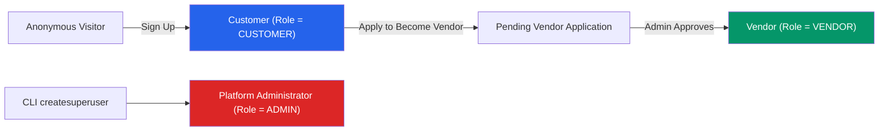
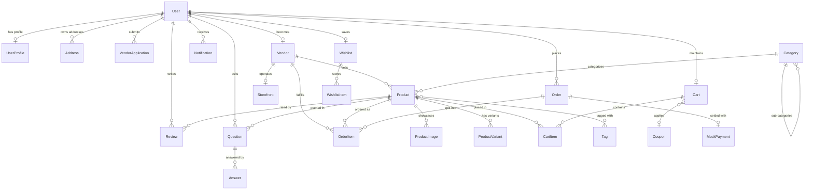
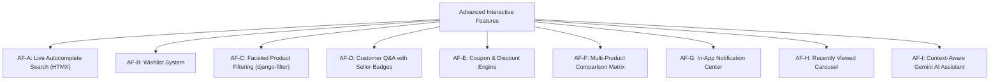
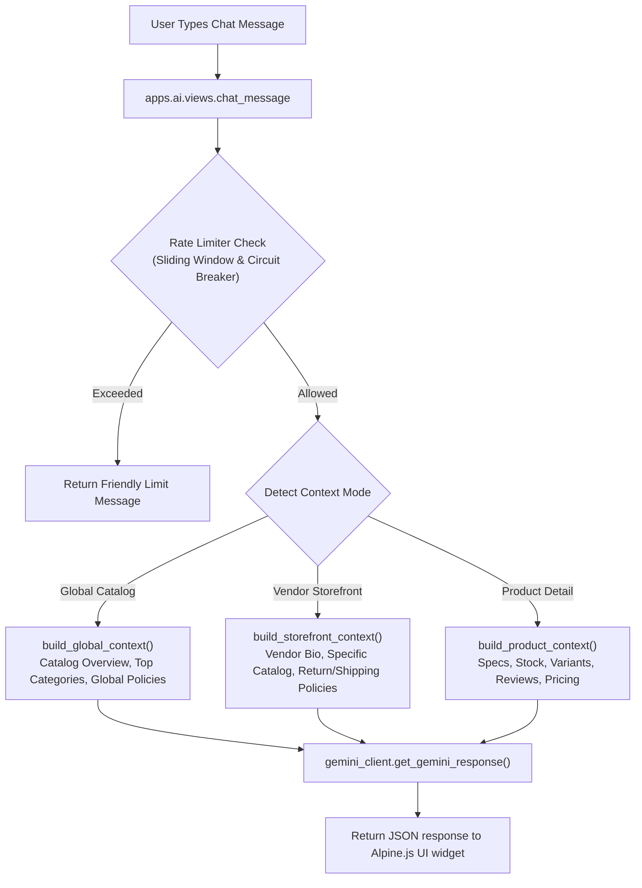
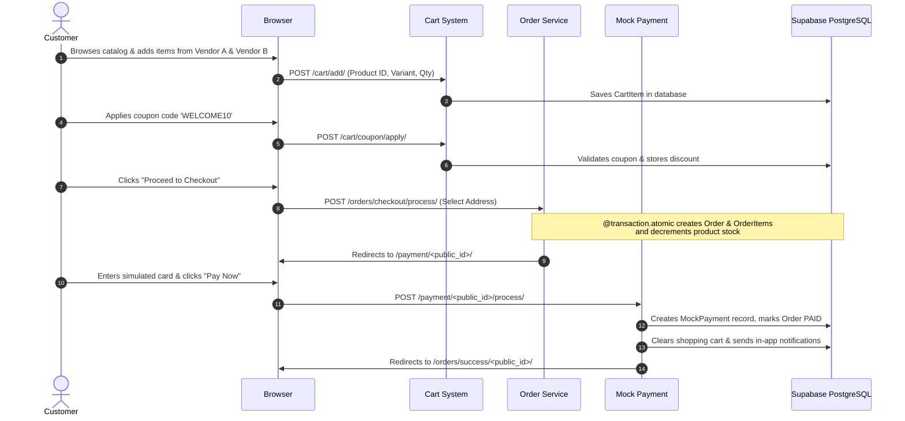
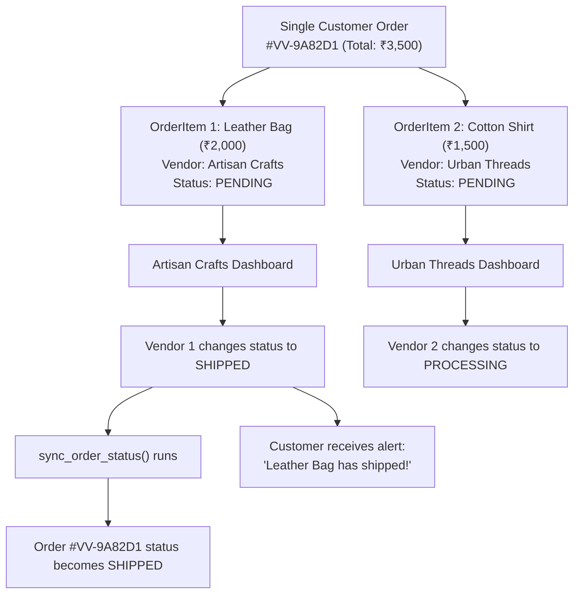

# Vendora (VendorVerse)
## Master Project Explanation & Viva Presentation Guide
### Multi-Vendor E-Commerce Marketplace Web Application
**Course:** Web Programming / Web Development using Python (iMCA Sem-VII / MCA / B.Tech / BCA)  
**Academic Year:** 2026 – 2027  
**Technology Stack:** Python 3.12, Django 5.x, PostgreSQL 16 (Supabase Cloud), HTMX, Alpine.js, Tailwind CSS 3.4, Google Gemini AI

---

## Quick Navigation / Table of Contents

1. [Executive Summary & Project Pitch](#1-executive-summary--project-pitch)
2. [Problem Statement & The Vendora Solution](#2-problem-statement--the-vendora-solution)
3. [User Roles & RBAC (Role-Based Access Control)](#3-user-roles--rbac-role-based-access-control)
4. [Complete Architecture: 10 Modular Django Apps](#4-complete-architecture-10-modular-django-apps)
5. [Database Architecture & Data Modeling (ERD + Data Dictionary)](#5-database-architecture--data-modeling)
6. [Core Technical Concepts & Django Methods Used](#6-core-technical-concepts--django-methods-used)
7. [Advanced Interactive Features (AF-A to AF-I)](#7-advanced-interactive-features)
8. [Embedded Google Gemini AI Assistant Architecture](#8-embedded-google-gemini-ai-assistant-architecture)
9. [Custom Executive Admin Dashboard & Analytics](#9-custom-executive-admin-dashboard--analytics)
10. [End-to-End User Journey & Workflow Diagrams](#10-end-to-end-user-journey--workflow-diagrams)
11. [Complete Page-by-Page & Route Inventory](#11-complete-page-by-page--route-inventory)
12. [Static vs Dynamic Pages Breakdown](#12-static-vs-dynamic-pages-breakdown)
13. [Frontend Design System & Hypermedia Architecture](#13-frontend-design-system--hypermedia-architecture)
14. [Security, Performance & ACID Transactions](#14-security-performance--acid-transactions)
15. [Academic Syllabus & University Deliverables Compliance](#15-academic-syllabus--university-deliverables-compliance)
16. [Live Demonstration Script (Step-by-Step for Presentation)](#16-live-demonstration-script-for-presentation)
17. [Professor Viva / Oral Defense Questions & Answers (35+ Q&A)](#17-professor-viva--oral-defense-questions--answers)
18. [Quick-Fire Elevator Pitches (30-Sec, 2-Min, 5-Min)](#18-quick-fire-elevator-pitches)

---

## 1. Executive Summary & Project Pitch

### What is Vendora (VendorVerse)?
**Vendora** (originally named **VendorVerse**) is an enterprise-grade, multi-vendor marketplace web application built with **Python 3.12** and **Django 5.x**. It allows **multiple independent merchants (vendors)** to register, configure personalized digital storefronts, list catalog products with variants, and fulfill customer orders.

Simultaneously, **customers** enjoy a unified, Amazon-like shopping experience: they can browse products from different vendors, compare items side-by-side, save favorites to a wishlist, add products from multiple stores into a single shared shopping cart, apply coupon discounts, execute a consolidated checkout, and track real-time fulfillment updates.

### One-Sentence Definition for Your Professor
> *"Vendora is a modular monolithic multi-vendor e-commerce platform built with Django 5 and cloud PostgreSQL, featuring multi-vendor cart splitting, atomic order processing, an executive admin analytics portal, and a context-aware Google Gemini AI shopper assistant."*

### Real-World Equivalents
| Feature | Real-World Equivalent |
|---|---|
| Multi-vendor catalog | **Amazon Marketplace, Etsy, Flipkart** |
| Dedicated vendor storefronts | **Shopify stores operating inside a unified marketplace mall** |
| Vendor approval & vetting | **Amazon Seller Central verification** |
| Cross-vendor cart & single checkout | **Amazon Multi-Seller Cart** |
| AI shopping assistant | **Amazon Rufus / Shopify Sidekick** |
| Split order fulfillment | **Flipkart Fulfilled / Amazon multi-shipment dispatch** |

---

## 2. Problem Statement & The Vendora Solution

### The Real-World Problems Small Sellers Face:
1. **High Barrier to Entry:** Building, hosting, securing, and maintaining a standalone e-commerce website costs thousands of dollars and requires technical expertise.
2. **Traffic & Trust Deficit:** Independent websites struggle to attract visitors and suffer from low consumer trust regarding payment security.
3. **Fragmented Customer Shopping:** Buyers wanting products from three different small makers must create 3 accounts, pay 3 shipping fees, and track 3 separate packages.
4. **Fulfillment & Cart Disconnection:** Standard shopping carts only support a single global seller; they cannot divide items among independent vendors.

### How Vendora Solves This:
1. **Zero-Setup Digital Storefronts:** Any approved vendor instantly gets a branded storefront (`/store/<slug>/`) with custom banners, logos, policies, and product grids.
2. **Unified Multi-Vendor Cart & Single Transaction:** Customers combine items from multiple independent vendors into one cart. Vendora executes a single payment and automatically partitions the items into vendor-specific orders.
3. **Automated Stock Decrement & ACID Consistency:** Database transactions guarantee that inventory is safely deducted across all vendors simultaneously without race conditions or overselling.
4. **Vendor Vetting & Customer Confidence:** Customers shop with confidence because platform administrators review and approve all vendor applications before stores can go live.
5. **AI-Powered Customer Assistance:** A built-in Google Gemini assistant answers customer questions about products, vendor policies, and site navigation in real time.

---

## 3. User Roles & RBAC (Role-Based Access Control)

Vendora enforces a strict **Role-Based Access Control (RBAC)** model with **3 primary user roles**:



### Role 1: Customer (`role = "CUSTOMER"`)
- **Who they are:** Regular shoppers.
- **Default State:** Every newly registered user automatically starts as a `CUSTOMER`.
- **Capabilities:**
  - Browse public product catalog with faceted category/price filters and sorting.
  - Live search with instant autocomplete suggestions.
  - View detailed product pages with multiple images, customer reviews, ratings, and Q&A.
  - Maintain a persistent database shopping cart.
  - Apply promotional coupon codes for instant percentage discounts.
  - Add/remove items from a personal **Wishlist**.
  - Compare up to 4 products side-by-side in the **Product Comparison Tool**.
  - Check out using a multi-field shipping address book.
  - Complete simulated card payment (with automatic Visa/Mastercard/Amex/Discover card brand detection).
  - View detailed customer order history with item-by-item status tracking.
  - Ask questions on products; submit star reviews and comments on purchased items.
  - View real-time in-app notifications (order status changes, answers to questions).
  - Use the Gemini AI Assistant for global, store, or product advice.
  - Apply to become a vendor via the self-service application form.

### Role 2: Vendor (`role = "VENDOR"`)
- **Who they are:** Independent store owners approved to sell on Vendora.
- **How they achieve this role:**
  1. Register as a customer.
  2. Submit the **"Become a Vendor"** application (`/vendors/apply/`) with business name, description, email, and phone.
  3. Status enters `PENDING`.
  4. Platform Administrator approves the application in the Admin panel.
  5. The system automatically creates a `Vendor` record, a `Storefront` record, and updates the user's role to `VENDOR`.
- **Capabilities (Retains ALL Customer capabilities + Merchant privileges):**
  - Access the **Vendor Dashboard** (`/vendors/dashboard/`) featuring dynamic KPI metrics (total products, active listings, order count, gross revenue, pending fulfillment counts, average rating).
  - Customize public **Storefront Settings** (logo upload, banner upload, tagline, store biography, return policy, shipping policy).
  - Full **Product Catalog CRUD**:
    - List own products with search and status filtering (`DRAFT`, `ACTIVE`, `ARCHIVED`).
    - Add new products with SKU, base price, sale price, stock quantity, and category.
    - Upload multiple product images with primary image selection via Django formsets.
    - Configure product variants (e.g., Size, Color) with custom pricing and separate inventory levels.
    - Edit existing products; delete products with confirmation safeguards.
  - **Vendor Order Management** (`/orders/vendor/orders/`):
    - View orders containing their products.
    - Inspect vendor-specific order details and line-item totals.
    - Advance individual order item statuses through the fulfillment lifecycle (`PENDING` ➔ `CONFIRMED` ➔ `PROCESSING` ➔ `SHIPPED` ➔ `DELIVERED`).
  - Answer customer questions asked on their product pages (tagged with an official "Seller" badge).
  - Receive automated in-app and email notifications when a customer purchases their products.

### Role 3: Platform Administrator (`role = "ADMIN"` / `is_staff = True`)
- **Who they are:** Site owners, moderators, and operations managers.
- **How they are created:** Via terminal command `python manage.py createsuperuser` or assigned `is_staff` privileges.
- **Capabilities:**
  - Access the custom **Executive Admin Dashboard** (`/admin/`) with real-time KPI overview tiles (Gross Paid Volume, Total Orders, Catalog Products, Active Sellers, Pending Applications).
  - Review, approve, or reject vendor applications with single-click bulk actions.
  - Manage product categories (hierarchical parent-child tree structure) and global product tags.
  - Audit all users, profiles, customer addresses, orders, payments, reviews, and notifications.
  - Create and manage platform promotional discount **Coupons** (code, percentage discount, max usages, validity window).
  - Moderate inappropriate reviews, questions, or product listings.

---

## 4. Complete Architecture: 10 Modular Django Apps

Vendora is structured as a **Modular Monolith** containing **10 dedicated applications** inside the `apps/` directory. Each app adheres to high cohesion and low coupling:

```
apps/
├── core/            # 🧱 Shared base models, mixins, custom error handlers, static company pages
├── accounts/        # 👤 User identity, authentication, profiles, and address book
├── vendors/         # 🏪 Vendor applications, merchant onboarding, storefronts, and seller dashboard
├── products/        # 📦 Catalog, categories, variants, images, live search, wishlist, compare, Q&A
├── cart/            # 🛒 Database-backed shopping cart, item management, and coupon calculation
├── orders/          # 📦 Multi-vendor orders, order items snapshot, fulfillment workflow, coupons
├── payments/        # 💳 Mock payment simulation, card brand detection, and transaction logging
├── reviews/         # ⭐ Product star ratings, verified purchase reviews, and deletion
├── notifications/   # 🔔 In-app notification center, unread counters, and transactional email services
└── ai/              # 🤖 Google Gemini AI assistant, dynamic multi-tier context builder, rate limiter
```

### Detailed Breakdown of Every Application:

| Application | Primary Responsibility | Key Models | Key Views / Services |
|---|---|---|---|
| **`apps.core`** | Abstract base models, global mixins, template tags, custom error pages, and company info | `TimeStampedModel`, `PublicIDModel` | `HomeView`, `SellingGuidesView`, `VendorPoliciesView`, `AboutView`, `custom_404`, `custom_500`, `get_admin_kpis` |
| **`apps.accounts`** | Custom user identity with email login, profile details, and multi-address management | `User`, `UserProfile`, `Address` | `ProfileView`, `AddressListView`, `AddressCreateView`, `AddressEditView`, `AddressDeleteView`, `VendoraAccountAdapter` |
| **`apps.vendors`** | Merchant application review, automated onboarding, dashboard metrics, and storefront customizer | `VendorApplication`, `Vendor`, `Storefront` | `VendorApplyView`, `VendorDashboardView`, `StorefrontSettingsView`, `VendorDirectoryView`, `StorefrontDetailView`, `approve_vendor_application()` |
| **`apps.products`** | Complete catalog browsing, hierarchical categories, variants, search, wishlist, compare, Q&A | `Category`, `Product`, `ProductImage`, `ProductVariant`, `Tag`, `Wishlist`, `WishlistItem`, `Question`, `Answer` | `ProductListView`, `ProductDetailView`, `ProductAutocompleteView`, `WishlistToggleView`, `CompareToggleView`, `QuestionCreateView`, `VendorProductCreateView` |
| **`apps.cart`** | Multi-vendor cart persistence, quantity threshold validation, and coupon discounting | `Cart`, `CartItem` | `AddToCartView`, `UpdateCartItemView`, `RemoveCartItemView`, `CartDetailView`, `ApplyCouponView`, `RemoveCouponView` |
| **`apps.orders`** | Atomic order creation from cart, vendor order partitioning, status state machine, and coupons | `Order`, `OrderItem`, `Coupon` | `CheckoutView`, `CheckoutProcessView`, `OrderSuccessView`, `CustomerOrderListView`, `VendorOrderListView`, `VendorOrderItemStatusView`, `create_order_from_cart()`, `sync_order_status()` |
| **`apps.payments`** | Simulated credit card checkout, card number formatting, brand detection, and transaction recording | `MockPayment` | `MockPaymentView`, `ProcessPaymentView`, `process_mock_payment()` |
| **`apps.reviews`** | Customer ratings (1-5 stars), text feedback, and verified purchase enforcement | `Review` | `SubmitReviewView`, `DeleteReviewView` |
| **`apps.notifications`** | In-app notification records, navbar alert badges, and transactional email dispatch | `Notification` | `NotificationListView`, `MarkAllReadView`, `NotificationReadRedirectView`, `send_order_confirmation_email()`, `send_vendor_new_order_email()` |
| **`apps.ai`** | Intelligent chat assistance with automatic context switching (Global / Storefront / Product) | *(Stateless / Session-backed)* | `chat_message`, `chat_status`, `build_global_context()`, `build_storefront_context()`, `build_product_context()`, `check_rate_limit()`, `get_gemini_response()` |

---

## 5. Database Architecture & Data Modeling

### Cloud Database Engine
- **Engine:** **PostgreSQL 16** hosted on **Supabase Cloud**.
- **Connection Optimization:** Configured with **PgBouncer** connection pooling (`CONN_MAX_AGE = 60` seconds to eliminate repetitive TLS handshakes, with `DISABLE_SERVER_SIDE_CURSORS = True`).
- **Development Fallback:** Local `db.sqlite3` is maintained for offline development.

### The Dual-Key Architecture (Critical Security & Performance Decision)
Every model in Vendora inherits from two abstract base classes in `apps.core.models`:
```python
class TimeStampedModel(models.Model):
    created_at = models.DateTimeField(auto_now_add=True, db_index=True)
    updated_at = models.DateTimeField(auto_now=True)
    class Meta:
        abstract = True

class PublicIDModel(models.Model):
    public_id = models.UUIDField(default=uuid.uuid4, unique=True, editable=False, db_index=True)
    class Meta:
        abstract = True
```
**Why this is a Masterclass Feature to Explain to Your Professor:**
1. **Performance:** The internal database uses standard 64-bit integer auto-increment primary keys (`id`). Foreign keys (`user_id`, `product_id`, `order_id`) join on integers, keeping indexes compact, cache-friendly, and blazing fast.
2. **Security & Anti-Enumeration (IDOR Prevention):** External public URLs and API routes NEVER expose sequential IDs (like `/orders/1/` or `/orders/2/`). Instead, they expose the UUID `public_id` (e.g., `/orders/success/9b1deb4d-3b7d-4bad-9bdd-2b0d7b3dcb6d/`). An attacker cannot guess other orders by incrementing numbers.

---

### Entity-Relationship (ER) Diagram



---

### Comprehensive Data Dictionary (Key Tables)

#### 1. `User` (`apps.accounts.models.User`)
*Extends `AbstractBaseUser` and `PermissionsMixin`.*
- `id` (BigAutoField, PK) — Internal integer key.
- `public_id` (UUID, Unique) — Public reference token.
- `email` (EmailField, Unique) — Primary login identifier (replaces username).
- `first_name`, `last_name` (CharField) — Customer's name.
- `role` (CharField) — Role enum: `CUSTOMER`, `VENDOR`, `ADMIN`.
- `is_active` (BooleanField, default=True) — Soft account toggle.
- `is_staff` (BooleanField, default=False) — Admin panel access flag.

#### 2. `Vendor` & `Storefront` (`apps.vendors.models`)
- `Vendor.user` (OneToOneField ➔ `User`) — The merchant account.
- `Vendor.business_name` (CharField) — Legal business name.
- `Vendor.is_active` (BooleanField) — Store active flag.
- `Storefront.vendor` (OneToOneField ➔ `Vendor`) — Store profile.
- `Storefront.slug` (SlugField, Unique) — Human-readable store URL path (`/store/<slug>/`).
- `Storefront.tagline`, `description` (TextField) — Store bio.
- `Storefront.logo`, `banner` (ImageField) — Branded merchant visual assets.
- `Storefront.return_policy`, `shipping_policy` (TextField) — Store customer assurances.

#### 3. `Product`, `ProductVariant`, `ProductImage` (`apps.products.models`)
- `Product.vendor` (ForeignKey ➔ `Vendor`, `on_delete=CASCADE`) — Owner merchant.
- `Product.category` (ForeignKey ➔ `Category`, `on_delete=SET_NULL`) — Catalog hierarchy.
- `Product.name`, `slug` (CharField, SlugField) — Title and URL token.
- `Product.base_price` (DecimalField) — Default retail price.
- `Product.compare_at_price` (DecimalField, nullable) — Original MSRP for strikethrough sale display.
- `Product.stock_quantity` (PositiveIntegerField) — Available inventory.
- `Product.status` (CharField) — Status enum: `DRAFT`, `ACTIVE`, `ARCHIVED`.
- `ProductVariant.product` (ForeignKey ➔ `Product`) — Parent product.
- `ProductVariant.name` (CharField) — e.g. "Size XL", "Navy Blue".
- `ProductVariant.price_override` (DecimalField, optional) — Custom variant price.
- `ProductVariant.stock_quantity` (PositiveIntegerField) — Variant-specific inventory.
- `ProductImage.image` (ImageField) — Uploaded photograph.
- `ProductImage.is_primary` (BooleanField) — Main thumbnail indicator.

#### 4. `Cart` & `CartItem` (`apps.cart.models`)
- `Cart.user` (OneToOneField ➔ `User`) — One active cart per customer.
- `Cart.coupon` (ForeignKey ➔ `Coupon`, nullable) — Currently applied discount code.
- `CartItem.cart` (ForeignKey ➔ `Cart`) — Cart container.
- `CartItem.product` (ForeignKey ➔ `Product`) — Target product.
- `CartItem.variant` (ForeignKey ➔ `ProductVariant`, nullable) — Selected variation.
- `CartItem.quantity` (PositiveIntegerField) — Units selected.
- *Constraint:* `unique_together = [("cart", "product", "variant")]`.

#### 5. `Order` & `OrderItem` (`apps.orders.models`)
- `Order.order_number` (CharField, Unique) — Human-readable tracking ID (e.g., `VV-7B29F41C`).
- `Order.user` (ForeignKey ➔ `User`) — Purchasing customer.
- `Order.shipping_name`, `shipping_address`, `shipping_city`, `shipping_state`, `shipping_postal_code` — **Immutable Address Snapshot** (saved at order time; changes to the user's address book will never corrupt past order history!).
- `Order.subtotal`, `discount_amount`, `shipping_cost`, `total` (DecimalField) — Financial totals.
- `Order.status` (CharField) — Lifecycle: `PENDING`, `CONFIRMED`, `PROCESSING`, `SHIPPED`, `DELIVERED`, `CANCELLED`.
- `Order.payment_status` (CharField) — `UNPAID`, `PAID`, `REFUNDED`.
- `OrderItem.order` (ForeignKey ➔ `Order`) — Parent order.
- `OrderItem.vendor` (ForeignKey ➔ `Vendor`) — **The key to multi-vendor splitting!**
- `OrderItem.product_name`, `variant_name`, `unit_price`, `quantity` — **Immutable Product Snapshot** (if vendor changes product price tomorrow, past orders retain the historical purchase price!).
- `OrderItem.status` (CharField) — Independent merchant fulfillment state (`PENDING` ➔ `DELIVERED`).

#### 6. `Coupon` (`apps.orders.models.Coupon`)
- `code` (CharField, Unique) — Promo code (e.g., `WELCOME10`).
- `discount_percentage` (PositiveIntegerField) — Percentage off subtotal.
- `max_uses`, `times_used` (PositiveIntegerField) — Usage limits and tracking counter.
- `valid_from`, `valid_until` (DateTimeField, optional) — Time-window restrictions.
- `is_active` (BooleanField) — Master enable toggle.

#### 7. `Review` (`apps.reviews.models.Review`)
- `product` (ForeignKey ➔ `Product`) — Reviewed item.
- `user` (ForeignKey ➔ `User`) — Author.
- `rating` (PositiveSmallIntegerField, 1 to 5) — Star rating.
- `is_verified_purchase` (BooleanField) — Automatically checked against database: set to `True` if user has a completed, paid order for this item!
- *Constraint:* `unique_together = [("product", "user")]` (prevents spamming multiple reviews on one product).

#### 8. `Notification` (`apps.notifications.models.Notification`)
- `id` (UUIDField, PK) — Unique notification ID.
- `user` (ForeignKey ➔ `User`) — Target recipient.
- `title` (CharField), `message` (TextField) — Notification payload.
- `is_read` (BooleanField, default=False) — Read receipt flag.
- `link` (CharField) — Dynamic destination URL for single-click navigation.

---

## 6. Core Technical Concepts & Django Methods Used

### 1. Django MVT (Model-View-Template) Architecture
Vendora follows the classic Django MVT pattern:
- **Model:** Represents database tables using Python classes (`apps/*/models.py`).
- **View:** Contains the business logic, fetches data through ORM, and selects templates (`apps/*/views/*.py`).
- **Template:** Renders semantic HTML enriched with Django Template Language (DTL) tags (`templates/**/*.html`).

### 2. Generic Class-Based Views (GCBVs)
Rather than writing messy procedural function-based views, Vendora uses standard Django class-based views:
- `ListView`: Used for paginated listings (`ProductListView`, `VendorDirectoryView`, `CustomerOrderListView`, `WishlistListView`).
- `DetailView`: Used for single-object representation (`ProductDetailView`, `StorefrontDetailView`, `CustomerOrderDetailView`).
- `TemplateView`: Used for pages rendering structured context (`HomeView`, `VendorDashboardView`, `CartDetailView`, `MockPaymentView`, `CompareListView`).
- `View`: Base class for custom HTTP method handlers (`AddToCartView`, `WishlistToggleView`, `CompareToggleView`, `VendorOrderItemStatusView`).

### 3. Service Layer Architecture (`services.py`)
To prevent "fat views" or "fat models", critical business logic is isolated into dedicated service functions:
- `approve_vendor_application(application, reviewer)` in `apps.vendors.services`: Atomically updates application status, generates the `Vendor` record, creates the `Storefront`, and elevates the user's role to `VENDOR`.
- `create_order_from_cart(user, cart, address)` in `apps.orders.services`: Wraps checkout in `@transaction.atomic`, calculates coupon discounts, creates line items, and decrements stock safely.
- `process_mock_payment(order, card_last_four, card_brand)` in `apps.orders.services`: Validates payment, writes `MockPayment` transaction, marks order `CONFIRMED`, triggers customer notification, vendor notification, and emails.
- `sync_order_status(order)` in `apps.orders.services`: Automatically aligns parent `Order.status` when vendors update individual `OrderItem.status`.

### 4. Database Query Optimizations (Preventing the N+1 Query Problem)
Every view querying related models leverages Django ORM optimizations:
```python
# select_related (SQL JOIN for One-to-One and ForeignKey relationships)
# prefetch_related (Separate query IN-lookup for Many-to-Many and reverse ForeignKeys)
Product.objects.filter(status=Product.Status.ACTIVE)
    .select_related("vendor", "vendor__storefront", "category")
    .prefetch_related("images", "variants", "tags")
```
This reduces database load from 50+ queries per page to just **2 or 3 queries**.

### 5. Custom Context Processors (`context_processors.py`)
Registered in `config/settings/base.py`, these run on every request to provide global context to all templates:
- `categories_processor`: Loads all active top-level categories and subcategories for the navbar mega-menu.
- `cart_processor`: Injects the current user's cart item count into the header cart badge.
- `notifications`: Injects the unread notification count into the bell icon.
- `recently_viewed_processor`: Injects recently viewed product objects.
- `compare_processor`: Injects active comparison count for the comparison floating pill.

### 6. Session Management & Cookies
Vendora uses server-side sessions with signed session cookies to manage:
- `request.session["recently_viewed"]`: Stores a list of product UUIDs viewed by the user.
- `request.session["compare_list"]`: Stores up to 4 product UUIDs being actively compared.
- `request.session["chat_history_global"]` & `request.session["chat_history_<slug>"]`: Stores conversation turns for the Gemini AI.
- `request.session["ai_request_timestamps"]`: Manages sliding-window rate limiting for the AI chat.

### 7. Formsets & ModelForms (`forms.py`)
- Standard `ModelForm` handles user input validation, CSRF verification, and database mapping (`ProductForm`, `VendorApplicationForm`, `AddressForm`).
- `inlineformset_factory`: Used in `apps.products.forms` to allow vendors to upload up to 3 product images and configure up to 2 product variants **within the exact same single form submission**!

---

## 7. Advanced Interactive Features

Vendora is loaded with sophisticated, real-world e-commerce features:



### 1. AF-A: Live Search with Autocomplete
- **How it works:** When a customer types in the search bar, HTMX (`hx-get="/products/autocomplete/"`) sends a query after a 300ms debounce.
- **Backend:** `ProductAutocompleteView` searches active products matching `name__icontains=query`, returning an instant HTML dropdown with thumbnails, prices, and vendor names.

### 2. AF-B: Persistent Wishlist
- **How it works:** Customers can click the heart icon on any product card or detail page.
- **Backend:** HTMX triggers `WishlistToggleView` via POST. The view checks `Wishlist` and `WishlistItem` models, creates or deletes the record, and swaps the button HTML to an active filled red heart without reloading the page.

### 3. AF-C: Faceted Product Filtering (`django-filter`)
- **Backend:** `ProductFilter` in `apps.products.filters` enables filtering by:
  - Text search (`q`) across title, description, vendor business name, and tags.
  - Category selector (automatically includes child subcategories).
  - Price range slider/inputs (`price_min`, `price_max`).
  - Sorting options (`newest`, `price_asc`, `price_desc`, `name_asc`).
- **HTMX Partial Swapping:** Changing any filter instantly re-renders `products/partials/product_grid.html` via HTMX!

### 4. AF-D: Customer Q&A on Product Pages
- Customers can post pre-purchase questions on any product page.
- Vendors and administrators can submit answers.
- Answers submitted by the product's vendor automatically receive an official **"Verified Seller"** badge.
- Automatic in-app notification alerts the customer when their question is answered.

### 5. AF-E: Coupon & Discount Engine
- Customers enter promo codes (e.g., `WELCOME10`) on the cart page.
- `ApplyCouponView` validates the coupon: checks if active, within validity dates, and under maximum usage limits.
- Cart subtotal recalculates with percentage discount applied; discount persists into final order creation.

### 6. AF-F: Product Comparison Matrix (Side-by-Side)
- Customers can add up to 4 products to their comparison tray.
- Stored cleanly in session storage (`request.session["compare_list"]`).
- Dedicated page (`/products/compare/`) displays a side-by-side comparison matrix showing Price, Rating, In-Stock status, Vendor Name, Category, and Description.

### 7. AF-G: In-App Notification Center
- Bell icon in the navbar shows a live red badge with unread alert count.
- Full notification feed at `/notifications/` with single-click "Mark All as Read".
- Clicking a notification triggers `NotificationReadRedirectView`, which marks the alert as read and redirects directly to the target order or question.

### 8. AF-H: Recently Viewed Products
- Stored dynamically in `request.session["recently_viewed"]` whenever a user visits a product detail page.
- Displayed as a carousel at the bottom of product pages and catalog views to encourage repeat browsing.

---

## 8. Embedded Google Gemini AI Assistant Architecture

Vendora features a context-aware AI Shopping Assistant built with Google's **Gemini API** (`gemini-2.5-flash` / `gemini-1.5-flash`), operating through a unified asynchronous endpoint (`/ai/chat/`).



### 3 Intelligent Context Modes:
1. **Global Mode (`/` or `/products/`):** Understands the entire marketplace, top-level categories, platform return guarantees, and directs shoppers to matching stores.
2. **Storefront Mode (`/store/<slug>/`):** Scoped specifically to one merchant. Ingests that vendor's storefront policies, business description, and full product line.
3. **Product Mode (`/products/<vendor>/<product>/`):** Ingests exact product specifications, stock availability, pricing, active variants, and verified customer review summaries to answer precise buyer questions.

### Production Safety Net & Rate Limiting:
- **Token Economy:** Truncates excessive user inputs to prevent quota drain; limits session conversation history to the last 10 turns.
- **Sliding-Window Limiter:** Limits users to 10 requests per minute and 50 per day per session.
- **Emergency Circuit Breaker:** Detects upstream Gemini API quota exhaustion (HTTP 429) and gracefully trips into a fallback mode without crashing the server.

---

## 9. Custom Executive Admin Dashboard & Analytics

Instead of leaving Django's default plain admin interface, Vendora completely revamps the Admin Portal (`templates/admin/index.html` and `templates/admin/base.html`):

```
+-----------------------------------------------------------------------------------------+
|                                Vendora Administration                                   |
|                     System Management & Executive Operations                           |
+-----------------------------------------------------------------------------------------+
|  [₹ Gross Paid Volume]   [Total Orders]       [Catalog Products]   [Active Sellers]     |
|     ₹142,500.00            48 Orders             124 Items            12 Merchants      |
|  ● Platform Volume       ⚡ 4 Pending Fulfilled ● Active Listings   ★ 2 Awaiting Review |
+-----------------------------------------------------------------------------------------+
|  [User & Accounts]       [Vendors & Stores]   [Products & Catalog] [Orders & Sales]     |
|  [Payments & Ledger]     [Customer Reviews]   [Notifications]      [AI Intelligence]    |
+-----------------------------------------------------------------------------------------+
```

### Executive KPI Bar (Powered by `get_admin_kpis` template tag):
1. **Gross Paid Volume:** Real-time sum of all paid orders across all vendors.
2. **Total Customer Orders:** Global order counter with pending fulfillment alert badge.
3. **Catalog Products:** Live count of active marketplace listings.
4. **Active Sellers & Pending Applications:** Live count of active vendors plus high-priority badge alerting admins to pending applications awaiting review.

---

## 10. End-to-End User Journey & Workflow Diagrams

### 1. Customer Shopping & Checkout Journey


### 2. Multi-Vendor Order Partitioning & Fulfillment


---

## 11. Complete Page-by-Page & Route Inventory

Vendora contains over **35 distinct views and templates**:

| # | Route / Page | URL Path | View Class / Handler | Access Role | Status |
|---|---|---|---|---|:---:|
| 1 | **Home / Landing Page** | `/` | `apps.core.views.HomeView` | Public | ✅ Complete |
| 2 | **User Sign Up** | `/accounts/signup/` | `allauth.account.views.SignupView` | Public | ✅ Complete |
| 3 | **User Login** | `/accounts/login/` | `allauth.account.views.LoginView` | Public | ✅ Complete |
| 4 | **User Logout** | `/accounts/logout/` | `allauth.account.views.LogoutView` | Logged In | ✅ Complete |
| 5 | **Password Reset Request** | `/accounts/password/reset/` | `allauth.account.views.PasswordResetView` | Public | ✅ Complete |
| 6 | **Password Reset Confirm** | `/accounts/password/reset/key/<key>/` | `allauth.account.views.PasswordResetFromKeyView` | Public | ✅ Complete |
| 7 | **Customer Profile** | `/profile/profile/` | `apps.accounts.views.ProfileView` | Logged In | ✅ Complete |
| 8 | **Address Book (CRUD)** | `/profile/addresses/` | `AddressListView`, `Create`, `Edit`, `Delete` | Logged In | ✅ Complete |
| 9 | **Vendor Application Form** | `/vendors/apply/` | `apps.vendors.views.VendorApplyView` | Customer | ✅ Complete |
| 10 | **Application Success** | `/vendors/apply/success/` | `VendorApplySuccessView` | Customer | ✅ Complete |
| 11 | **Vendor Dashboard** | `/vendors/dashboard/` | `apps.vendors.views.VendorDashboardView` | Vendor Only | ✅ Complete |
| 12 | **Storefront Settings** | `/vendors/dashboard/storefront/` | `StorefrontSettingsView` | Vendor Only | ✅ Complete |
| 13 | **Vendor Products List** | `/products/manage/` | `VendorProductListView` | Vendor Only | ✅ Complete |
| 14 | **Vendor Add Product** | `/products/manage/add/` | `VendorProductCreateView` | Vendor Only | ✅ Complete |
| 15 | **Vendor Edit Product** | `/products/manage/<id>/edit/` | `VendorProductEditView` | Vendor Only | ✅ Complete |
| 16 | **Vendor Delete Product** | `/products/manage/<id>/delete/` | `VendorProductDeleteView` | Vendor Only | ✅ Complete |
| 17 | **Vendor Order List** | `/orders/vendor/orders/` | `VendorOrderListView` | Vendor Only | ✅ Complete |
| 18 | **Vendor Order Detail** | `/orders/vendor/orders/<id>/` | `VendorOrderDetailView` | Vendor Only | ✅ Complete |
| 19 | **Update Item Status** | `/orders/vendor/orders/item/<id>/status/` | `VendorOrderItemStatusView` | Vendor Only | ✅ Complete |
| 20 | **Public Vendor Directory** | `/vendors/` | `apps.vendors.views.VendorDirectoryView` | Public | ✅ Complete |
| 21 | **Public Storefront** | `/store/<slug>/` | `apps.vendors.views.StorefrontDetailView` | Public | ✅ Complete |
| 22 | **Public Product Catalog** | `/products/` | `apps.products.views.ProductListView` | Public | ✅ Complete |
| 23 | **Live Autocomplete Search** | `/products/autocomplete/` | `ProductAutocompleteView` (HTMX) | Public | ✅ Complete |
| 24 | **Public Product Detail** | `/products/<vendor>/<product>/` | `ProductDetailView` | Public | ✅ Complete |
| 25 | **Wishlist Listing** | `/products/wishlist/` | `WishlistListView` | Logged In | ✅ Complete |
| 26 | **Wishlist Toggle** | `/products/wishlist/<id>/toggle/` | `WishlistToggleView` (HTMX) | Logged In | ✅ Complete |
| 27 | **Product Compare Page** | `/products/compare/` | `CompareListView` | Public | ✅ Complete |
| 28 | **Shopping Cart Page** | `/cart/` | `apps.cart.views.CartDetailView` | Logged In | ✅ Complete |
| 29 | **Add to Cart** | `/cart/add/` | `apps.cart.views.AddToCartView` | Logged In | ✅ Complete |
| 30 | **Apply / Remove Coupon** | `/cart/coupon/apply/` & `/remove/` | `ApplyCouponView`, `RemoveCouponView` | Logged In | ✅ Complete |
| 31 | **Checkout Page** | `/orders/checkout/` | `apps.orders.views.CheckoutView` | Logged In | ✅ Complete |
| 32 | **Mock Payment Page** | `/payment/<id>/` | `apps.payments.views.MockPaymentView` | Logged In | ✅ Complete |
| 33 | **Order Success / Invoice** | `/orders/success/<id>/` | `apps.orders.views.OrderSuccessView` | Logged In | ✅ Complete |
| 34 | **Customer Order History** | `/orders/my-orders/` | `CustomerOrderListView` | Logged In | ✅ Complete |
| 35 | **Customer Order Tracking** | `/orders/my-orders/<id>/` | `CustomerOrderDetailView` | Logged In | ✅ Complete |
| 36 | **Submit Product Review** | `/reviews/submit/<id>/` | `apps.reviews.views.SubmitReviewView` | Logged In | ✅ Complete |
| 37 | **Customer Q&A Submit** | `/products/<id>/ask/` & `/answer/` | `QuestionCreateView`, `AnswerCreateView` | Logged In | ✅ Complete |
| 38 | **In-App Notifications** | `/notifications/` | `NotificationListView`, `MarkAllReadView` | Logged In | ✅ Complete |
| 39 | **AI Assistant Endpoint** | `/ai/chat/` & `/ai/status/` | `apps.ai.views.chat_message` | Public | ✅ Complete |
| 40 | **Custom Admin Portal** | `/admin/` | Django Admin + Custom KPI Dashboard | Admin Only | ✅ Complete |
| 41 | **Informational & Policy** | `/about/`, `/help/`, `/privacy/` | Core TemplateViews | Public | ✅ Complete |
| 42 | **Custom Error Pages** | `404.html`, `500.html` | `custom_404`, `custom_500` | Public | ✅ Complete |

---

## 12. Static vs Dynamic Pages Breakdown

### What is a Static Page?
A static page delivers identical HTML content to every visitor regardless of user login status or database state (e.g., Terms of Service, Privacy Policy).

### What is a Dynamic Page?
A dynamic page executes server-side code (database queries, session checks, authentication logic) to compile personalized, real-time HTML before returning it to the browser.

### Vendora Dynamic Classification Table:
Every primary page in Vendora is **dynamic** because it interfaces with PostgreSQL or checks authentication state:

| Page | Type | Why It Is Dynamic |
|---|---|---|
| **Home Page** | Dynamic | Calculates live vendor count, product count, customer count, average platform rating, and displays auth-aware CTA banners. |
| **Product Catalog** | Dynamic | Queries PostgreSQL with faceted filters (price, categories, search string), annotating whether each product is in the user's wishlist. |
| **Product Detail** | Dynamic | Fetches variant stock, related products, customer reviews, verified purchase status, Q&A records, and tracks recently viewed products in session. |
| **Cart & Checkout** | Dynamic | Calculates live line totals, checks remaining stock quantities, applies coupon percentages, and verifies shipping addresses. |
| **Vendor Dashboard** | Dynamic | Queries database aggregates for gross sales volume, pending orders, product listings, and recent orders. |
| **Custom Admin** | Dynamic | Computes live KPI metrics across all 10 modules on every page load. |

---

## 13. Frontend Design System & Hypermedia Architecture

### Tech Stack
1. **HTML5:** Semantic markup (`<header>`, `<main>`, `<article>`, `<section>`, `<footer>`).
2. **Tailwind CSS 3.4 (CDN):** Modern utility-first styling with custom palette tokens (Primary Teal `#0d9488`, Secondary Violet `#7c3aed`, Indigo, Rose). Fully responsive across mobile, tablet, and desktop.
3. **HTMX 1.9 (CDN):** Enables modern AJAX-like partial DOM updates directly from HTML attributes without writing custom JavaScript:
   - `hx-get="/products/autocomplete/"` ➔ Instant search suggestions.
   - `hx-post="/products/wishlist/<id>/toggle/"` ➔ Toggle wishlist heart without page reload.
   - `hx-target="#product-grid"` ➔ Swaps product cards smoothly during faceted filtering.
4. **Alpine.js 3.x (CDN):** Lightweight reactive client framework for toggling modals, mobile hamburger menus, flash message auto-dismiss (3 seconds), and animated number counters.
5. **Google Fonts (Inter):** Clean, professional modern typography.

---

## 14. Security, Performance & ACID Transactions

### 1. ACID Transactions for Financial Integrity
In `apps/orders/services.py`, order creation is wrapped in Django's atomic transaction decorator:
```python
@transaction.atomic
def create_order_from_cart(user, cart, address):
    # 1. Calculates subtotal and coupon discounts
    # 2. Creates the Order record with snapshot address
    # 3. Loops through cart items, creating OrderItems
    # 4. Safely decrements stock quantities for products/variants
    # IF ANYTHING FAILS (e.g. database error), ALL CHANGES ARE ROLLED BACK AUTOMATICALLY!
```
**Why this matters:** If an error occurs halfway through checkout, the database rolls back completely. The customer is never charged without an order being created, and stock counts never get corrupted.

### 2. Built-in Security Protections:
- **CSRF Protection:** Every form contains `` to prevent Cross-Site Request Forgery attacks.
- **SQL Injection Prevention:** All queries use Django's ORM parameterization (`Product.objects.filter(...)`); zero raw concatenated SQL queries.
- **XSS (Cross-Site Scripting) Defense:** Django's template engine auto-escapes all output variables (`{{ product.name }}`).
- **Clickjacking Prevention:** `XFrameOptionsMiddleware` blocks malicious iframe embedding.
- **Password Security:** Salted and hashed using industry-standard **PBKDF2 with SHA-256**.
- **Role Permission Guards:** Class-based views use `LoginRequiredMixin` and `VendorRequiredMixin` to reject unauthorized access attempts.

---

## 15. Academic Syllabus & University Deliverables Compliance

*(Specifically aligned with GLS University iMCA Semester VII / MCA Web Development using Python guidelines)*

| Prescribed University Requirement | How Vendora Complies |
|---|---|
| **1. Install & Configure Django** | Django 5.x installed under virtual environment with split settings (`base.py`, `development.py`, `production.py`). |
| **2. Mandatory Custom Templates** | Completely custom HTML5 + Tailwind CSS templates with layout inheritance (`templates/base.html`, `_navbar.html`, `_footer.html`). Zero pre-baked bootstrap templates. |
| **3. Appropriate Views & Customizations** | 35+ Generic Class-Based Views (`ListView`, `DetailView`, `TemplateView`, `View`) and custom security mixins (`VendorRequiredMixin`). |
| **4. At Least 1 User-Defined Model** | **15+ interconnected models** across 10 apps (`User`, `Vendor`, `Product`, `ProductVariant`, `Cart`, `Order`, `Coupon`, `Review`, `Notification`, etc.). |
| **5. At Least 1 Filter in Admin Panel** | Extensive `list_filter` configurations across all models (by role, active status, category, date, order status). |
| **6. Cookies & Session Settings** | Session-backed shopping cart synchronization, session-tracked **Recently Viewed Products**, session-backed **Product Comparison Tool**, and session-keyed AI rate limiting. |
| **7. REST API Interface** | RESTful JSON endpoints for live autocomplete search (`/products/autocomplete/`), AI chat interaction (`/ai/chat/`), and quota telemetry (`/ai/status/`). |

---

## 16. Live Demonstration Script for Presentation

Follow this exact sequence during your practical exam or presentation:

### Step 1: Landing Page & Live Statistics (1 Minute)
- Open `http://127.0.0.1:8000/`.
- Point out the modern Tailwind styling, responsive navbar, category mega-menu dropdown, and hero banner.
- Highlight the **live statistics bar**: *"Professor, these numbers are not hardcoded. They are dynamically calculated from our PostgreSQL database—counting verified vendors, active catalog products, and completed orders."*

### Step 2: Catalog Browsing, Live Autocomplete & Faceted Filtering (1 Minute)
- Navigate to `/products/`.
- Type "shirt" or "bag" in the search box: show the **live autocomplete dropdown** appearing without page reload.
- Adjust the price filter or click a category: point out how HTMX updates the product grid smoothly without a full page refresh.
- Click the heart icon on a card: demonstrate the **Wishlist toggle** instant animation.
- Click the comparison button: show the floating comparison indicator updating.

### Step 3: Product Detail, Variants & Customer Q&A (1 Minute)
- Click on a product to open `/products/<vendor>/<product>/`.
- Show multi-image carousel thumbnails, price strikethroughs, and variant selector dropdown.
- Scroll down to the **Customer Q&A section**: point out how questions can be asked by customers and answered by vendors (with verified seller badges).
- Show the **Verified Purchase Reviews**: explain that only users with delivered orders can leave star ratings.

### Step 4: Product Comparison Matrix (30 Seconds)
- Click the floating "Compare (X)" button to open `/products/compare/`.
- Show the side-by-side spec comparison table comparing price, rating, stock status, and vendor.

### Step 5: Multi-Vendor Cart & Promo Coupon (1 Minute)
- Add products from two different vendors into the shopping cart.
- Navigate to `/cart/`.
- Point out: *"Professor, notice that our cart holds items from multiple independent vendors simultaneously."*
- Enter coupon code `WELCOME10` and click Apply: show the 10% discount immediately recalculating the order total.

### Step 6: Checkout & Simulated Card Payment (1 Minute)
- Click "Proceed to Checkout" (`/orders/checkout/`).
- Select a shipping address from the user's address book.
- Click "Place Order & Pay": explain that `@transaction.atomic` has safely partitioned the order into vendor line-items and decremented inventory.
- On the mock payment screen (`/payment/<id>/`), enter a test card number (e.g. starting with `4` for Visa or `5` for Mastercard): show automatic card brand detection.
- Click "Pay Now": watch the simulated payment process and redirect to the beautiful Order Success Invoice page.

### Step 7: Customer Order Tracking & In-App Notifications (30 Seconds)
- Navigate to `/orders/my-orders/`: inspect the newly placed order.
- Look at the top navbar bell icon: show the red notification badge alerting the customer that their order was confirmed.

### Step 8: Vendor Dashboard & Fulfillment Lifecycle (1 Minute)
- Log in as the vendor who owns one of the ordered items.
- Navigate to `/vendors/dashboard/`: point out the real-time gross revenue, order counts, and recent orders.
- Open `/orders/vendor/orders/`: open the order and change the item status from `CONFIRMED` to `PROCESSING` to `SHIPPED`.
- Explain: *"When the vendor updates their item status, our `sync_order_status` service automatically updates the customer's parent order and dispatches an in-app notification."*

### Step 9: Context-Aware Google Gemini AI Assistant (1 Minute)
- Click the floating AI assistant button in the bottom right corner.
- In Global mode: ask *"What can I buy on Vendora?"* — show intelligent category guidance.
- Open a vendor's storefront and ask *"What is your return policy?"* — show the AI dynamically pulling context directly from that vendor's database record.

### Step 10: Custom Executive Admin Portal (1 Minute)
- Open `/admin/` in an incognito window as the superuser.
- Showcase the **Executive KPI Overview Bar** (Gross Paid Volume, Total Orders, Catalog Products, Active Sellers, Pending Applications).
- Demonstrate reviewing and approving a pending vendor application with a single bulk click.

---

## 17. Professor Viva / Oral Defense Questions & Answers

### General & Project Concept
**Q1: What is the main objective of your project?**  
*Answer:* The main objective of Vendora is to build a scalable, multi-vendor e-commerce marketplace where independent sellers can create digital storefronts and sell products, while customers enjoy a consolidated catalog, shared shopping cart, unified checkout, and AI-assisted shopping.

**Q2: How does a multi-vendor marketplace differ from a regular e-commerce website?**  
*Answer:* A standard e-commerce website (like a single brand store) has one seller and one inventory. A multi-vendor marketplace (like Amazon or Etsy) hosts multiple independent sellers. It requires role-based access control, merchant application workflows, partitioned order fulfillment, vendor-specific storefronts, and cross-vendor cart management.

**Q3: How many user roles exist in Vendora?**  
*Answer:* Three distinct roles: **Customer** (default registered user), **Vendor** (approved merchant managing products and storefront), and **Platform Admin** (administrator managing approvals, moderation, and site configuration).

---

### Django Architecture & Concepts
**Q4: What is Django's MVT architecture?**  
*Answer:* MVT stands for Model-View-Template. The **Model** defines the database schema via Python classes. The **View** receives HTTP requests, executes business logic, and queries models via ORM. The **Template** defines the visual presentation using HTML and Django Template Language (DTL).

**Q5: What is the difference between MVC and MVT?**  
*Answer:* In standard MVC (Model-View-Controller), the Controller handles user input and routing. In Django's MVT, the framework itself acts as the Controller (via `urls.py` and request dispatching), while Django's "View" acts like the traditional Controller, and the "Template" acts as the View.

**Q6: What are Generic Class-Based Views (GCBVs) and why did you use them?**  
*Answer:* GCBVs (`ListView`, `DetailView`, `TemplateView`) are pre-built Django classes that encapsulate common web development patterns. They eliminate boilerplate code, promote DRY principles, and make it easy to extend behavior using mixins like `LoginRequiredMixin` and `VendorRequiredMixin`.

**Q7: What is a Django Context Processor?**  
*Answer:* A context processor is a Python function that automatically injects data into the context of every rendered template. We use custom context processors to supply category mega-menu data, cart item counts, unread notification counts, and comparison data globally across all pages.

**Q8: What is Django's ORM and why is it beneficial?**  
*Answer:* ORM (Object-Relational Mapping) allows developers to query and manipulate database records using Python code instead of raw SQL. It provides database engine independence (PostgreSQL, SQLite, MySQL), protects against SQL injection via parameterized queries, and makes code maintainable.

---

### Database & Data Modeling
**Q9: Why did you use both an integer `id` and a UUID `public_id` on your models?**  
*Answer:* This is our **Dual-Key Architecture**. Internal database joins and foreign key indexes use 64-bit integer primary keys (`id`) for optimal query performance and memory caching. However, public URLs and API routes exclusively expose the UUID `public_id` to prevent **Insecure Direct Object Reference (IDOR)** attacks and enumeration of user orders or customer profiles.

**Q10: What is the N+1 query problem and how did you prevent it?**  
*Answer:* The N+1 query problem occurs when querying a parent table (1 query) causes the ORM to execute an additional query for every child record (N queries) inside a template loop. We prevented this by using `select_related()` for One-to-One and ForeignKey relationships (executing an SQL JOIN) and `prefetch_related()` for Many-to-Many and reverse foreign keys (executing a single batch IN-lookup).

**Q11: What database did you use and how is it connected?**  
*Answer:* We use **PostgreSQL 16** hosted on **Supabase Cloud**, connected via `DATABASE_URL` using `psycopg2`. We configured connection pooling via PgBouncer with `CONN_MAX_AGE = 60` seconds to eliminate repetitive TLS handshakes on every web request.

**Q12: Why do you store address and product price snapshots in `Order` and `OrderItem`?**  
*Answer:* For **immutable historical integrity**. If a customer edits their saved address next month, or a vendor raises a product price from ₹500 to ₹800, past completed orders must retain the exact shipping destination and purchase price agreed upon at the time the transaction took place.

---

### Business Logic & Workflows
**Q13: How does the vendor approval workflow work in code?**  
*Answer:* A customer submits an application form, creating a `VendorApplication` with status `PENDING`. In the admin panel, the admin selects "Approve". This executes `approve_vendor_application()` in `apps/vendors/services.py`, which sets status to `APPROVED`, creates a new `Vendor` record, generates an empty `Storefront` with a slugified business name, and changes `user.role` from `CUSTOMER` to `VENDOR`.

**Q14: What happens during checkout when an order contains items from multiple vendors?**  
*Answer:* In `create_order_from_cart()`, a single master `Order` record is created for the customer. Then, a loop iterates through each `CartItem`, creating an `OrderItem` linked directly to that specific product's `vendor`. This allows each vendor to view and fulfill only their respective items in their vendor portal.

**Q15: What are ACID transactions and where did you implement them?**  
*Answer:* ACID stands for Atomicity, Consistency, Isolation, and Durability. We applied Django's `@transaction.atomic` decorator to `create_order_from_cart()`. If creating line items or decrementing product inventory fails at any step, the entire database transaction rolls back, guaranteeing zero orphaned or corrupted records.

---

### Frontend, APIs & Artificial Intelligence
**Q16: What is HTMX and why did you use it instead of React or Vue?**  
*Answer:* HTMX allows us to perform AJAX requests, CSS transitions, and partial HTML DOM swaps directly through HTML attributes (e.g. `hx-get`, `hx-target`, `hx-swap`). It gives us the fluid, SPA-like responsiveness of React without needing a complex Node.js build pipeline, JSON API serializers, client-side state duplication, or SEO disadvantages.

**Q17: What does Alpine.js do in your project?**  
*Answer:* Alpine.js is a lightweight reactive JavaScript framework that handles client-side UI interactivity—such as toggling dropdown menus, opening confirmation modals, auto-dismissing flash messages after 3 seconds, and animating number counters.

**Q18: How does the Google Gemini AI assistant work?**  
*Answer:* When a customer sends a message to `/ai/chat/`, the backend identifies the context mode (Global, Storefront, or Product). It queries the database to build a dynamic system prompt containing relevant catalog info, store policies, or product specifications. It then calls the Gemini API (`gemini-2.5-flash`), appends the response to session chat history, and returns the reply as JSON.

**Q19: How did you prevent AI quota crashes or API abuse?**  
*Answer:* We built a sliding-window rate limiter in `apps/ai/rate_limiter.py` restricting users to 10 requests per minute and 50 per day. Additionally, we implemented an emergency circuit breaker that catches HTTP 429 quota errors and switches to a fallback response mode instead of crashing.

---

### Security & Production Standards
**Q20: What security features are built into your Django project?**  
*Answer:*
1. CSRF tokens on all POST forms to stop cross-site request forgery.
2. ORM query parameterization to stop SQL injection.
3. Automated template output escaping to stop Cross-Site Scripting (XSS).
4. PBKDF2 with SHA-256 password hashing.
5. `SecurityMiddleware` for security headers and clickjacking protection.
6. Role-based view mixins to block unauthorized URL access.

---

## 18. Quick-Fire Elevator Pitches

### The 30-Second Elevator Pitch
> *"Vendora is a multi-vendor e-commerce marketplace built with Django 5 and cloud PostgreSQL. It enables independent merchants to set up custom storefronts and sell products, while customers shop across stores using a single multi-vendor cart and unified checkout. It features atomic inventory management, live autocomplete search, and an embedded Google Gemini AI shopping copilot."*

### The 2-Minute Comprehensive Pitch
> *"Respected professors, our project is Vendora, an enterprise-grade multi-vendor e-commerce marketplace developed using Python 3.12, Django 5.x, and PostgreSQL hosted on Supabase Cloud.
>
> In traditional e-commerce, small sellers struggle with the high cost of building their own websites, while customers must shop across disconnected stores. Vendora solves this through a unified marketplace architecture.
>
> We designed a modular monolith comprising 10 distinct Django applications. It supports 3 user roles: Customers, Vendors, and Administrators. Customers can browse products with faceted filters, live autocomplete search, product comparison, and wishlists. They can combine items from multiple independent vendors into a single cart, apply coupon discounts, and complete a simulated card checkout.
>
> Behind the scenes, Vendora uses atomic database transactions to safely partition orders among vendors and decrement inventory. Each vendor accesses a dedicated seller dashboard to manage products and advance fulfillment status. Finally, we integrated Google Gemini AI to provide real-time, context-aware shopper guidance across the platform."*

### The 5-Minute Technical Deep-Dive
*(Use this if the professor asks you to explain the full architecture and database design)*
> *"Our architecture implements standard enterprise software engineering principles:
>
> 1. **Modular Monolith:** Rather than microservices or one massive app, we divided functionality into 10 cohesive Django apps: `accounts`, `vendors`, `products`, `cart`, `orders`, `payments`, `reviews`, `notifications`, `ai`, and `core`.
>
> 2. **Dual-Key Data Architecture:** To optimize database speed while preventing enumeration attacks (IDOR), all models inherit from `PublicIDModel` and `TimeStampedModel`. We use 64-bit integer primary keys internally for fast database indexing, but expose random UUIDs in all public URLs.
>
> 3. **Service Layer Pattern:** Business logic is decoupled from views into `services.py`. For example, `approve_vendor_application()` coordinates multi-step merchant onboarding, and `create_order_from_cart()` handles atomic checkout and stock deductions.
>
> 4. **Hypermedia-Driven Frontend:** By pairing Tailwind CSS with HTMX and Alpine.js, we achieved a modern, reactive single-page feel for live autocomplete, wishlist toggles, and faceted filters—without the complexity or SEO drawbacks of a full React framework.
>
> 5. **Intelligence & Telemetry:** We built an executive KPI dashboard inside the Django admin panel calculating real-time platform transaction volume, and integrated Google Gemini AI with session rate limiting and an emergency circuit breaker."*

---

## 14. College Evaluation Deliverables & Viva Answers (Cheat-Sheet)

If your professor evaluates your project against specific practical criteria, use these exact points and file locations:

| # | Practical Exam Deliverable | How Vendora Satisfies It | Exact File Reference |
|---|---|---|---|
| **1** | **Mandatory Customized Templates for Design Consistency** | Custom global base layout (`templates/base.html`) and custom admin layout (`templates/admin/base.html`, `templates/admin/index.html`). Shared design tokens, typography (`Inter` & `Outfit`), unified navigation bar, footer, and interactive SaaS admin sidebar. | [templates/base.html](file:///c:/Users/SHABBIR%20G/Desktop/VendorVerse/templates/base.html)<br>[templates/admin/base.html](file:///c:/Users/SHABBIR%20G/Desktop/VendorVerse/templates/admin/base.html) |
| **2** | **Appropriate Views, Templates to Represent Customization** | Modular view architecture: class-based views (`ProductDetailView`, `StorefrontView`) and function views (`search_autocomplete_view`, `analytics_dashboard_view`). Custom styled templates with HTMX partial rendering for modals, cart off-canvas, and dynamic tabs. | [apps/products/views/web.py](file:///c:/Users/SHABBIR%20G/Desktop/VendorVerse/apps/products/views/web.py)<br>[apps/vendors/views.py](file:///c:/Users/SHABBIR%20G/Desktop/VendorVerse/apps/vendors/views.py) |
| **3** | **At Least 1 User-Defined Model** | Over 15 custom models. Highlight `Product`, `Vendor`, or `Order`: inherits from custom abstract `PublicIDModel` and `TimeStampedModel` with slug auto-generation, custom managers, and database constraints. | [apps/products/models.py](file:///c:/Users/SHABBIR%20G/Desktop/VendorVerse/apps/products/models.py)<br>[apps/vendors/models.py](file:///c:/Users/SHABBIR%20G/Desktop/VendorVerse/apps/vendors/models.py) |
| **4** | **At Least 1 Filter on Admin Panel** | Rich multi-faceted filters configured via `list_filter`. In `ProductAdmin`: `list_filter = ("status", "is_featured", "category", "vendor")`. In `OrderAdmin`: `list_filter = ("status", "created_at")`. Renders as modern pill buttons with active state checkmarks. | [apps/products/admin.py:L62](file:///c:/Users/SHABBIR%20G/Desktop/VendorVerse/apps/products/admin.py#L62)<br>[apps/orders/admin.py](file:///c:/Users/SHABBIR%20G/Desktop/VendorVerse/apps/orders/admin.py) |
| **5** | **Cookies and Session Settings** | Configured in `settings/base.py`: Django session engine (`SessionMiddleware`), anonymous guest cart tracking stored in session (`cart_id`), CSRF cookie security (`CSRF_COOKIE_HTTPONLY`, `SESSION_COOKIE_AGE = 1209600`), and flash messages via cookies. | [config/settings/base.py](file:///c:/Users/SHABBIR%20G/Desktop/VendorVerse/config/settings/base.py)<br>[apps/cart/services.py](file:///c:/Users/SHABBIR%20G/Desktop/VendorVerse/apps/cart/services.py) |
| **6** | **REST API Interface of User-Defined Model** | Django REST Framework (DRF) endpoints with ModelSerializers and ViewSets. Complete REST API for Products (`/api/v1/products/`) with pagination, filtering, search, and JSON payloads. | [apps/products/serializers.py](file:///c:/Users/SHABBIR%20G/Desktop/VendorVerse/apps/products/serializers.py)<br>[apps/products/views/api.py](file:///c:/Users/SHABBIR%20G/Desktop/VendorVerse/apps/products/views/api.py) |

---
*End of Presentation Guide — Good luck with your project viva!*
