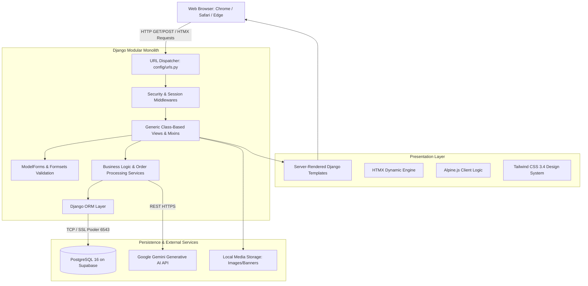
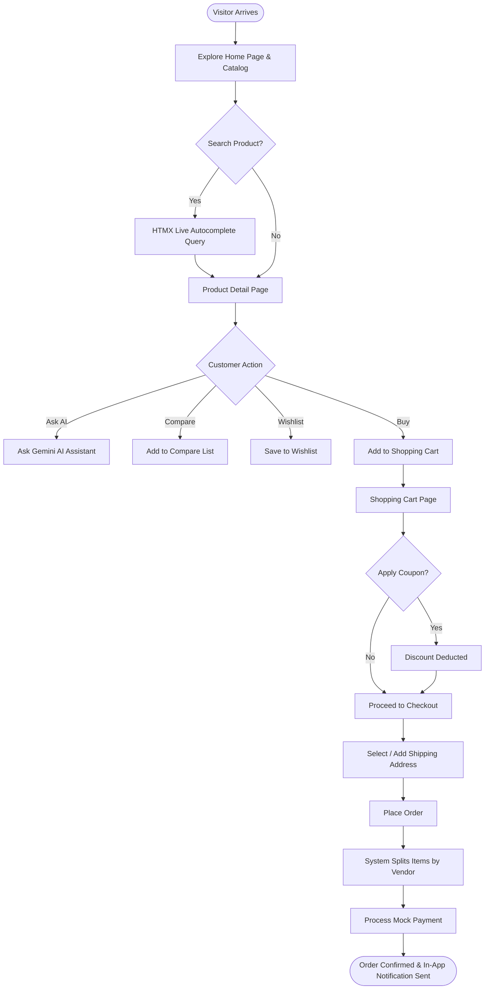
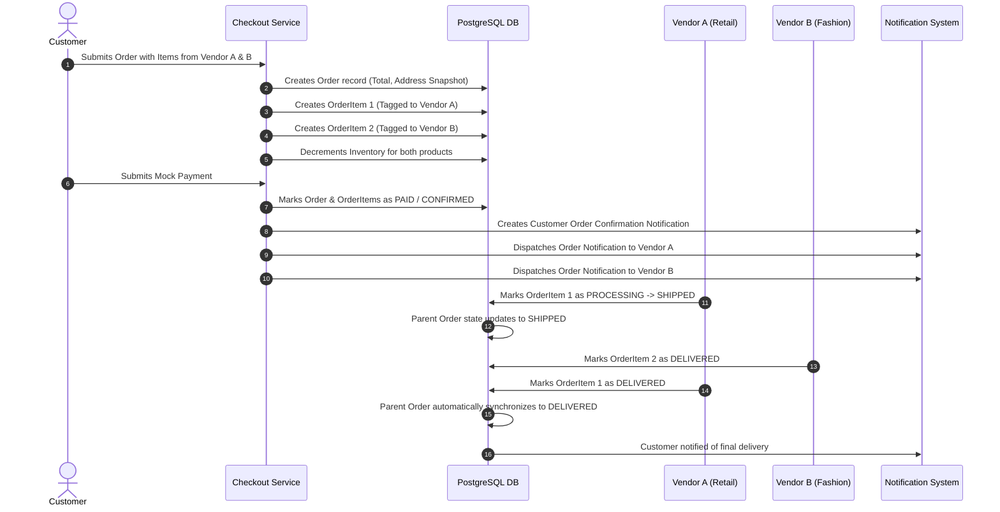
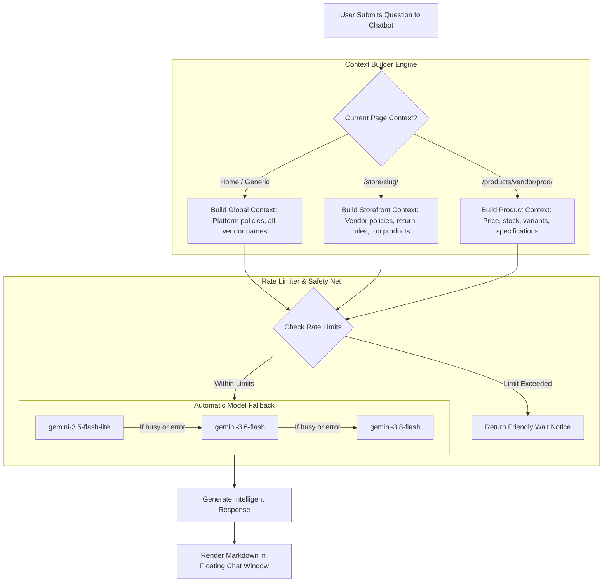
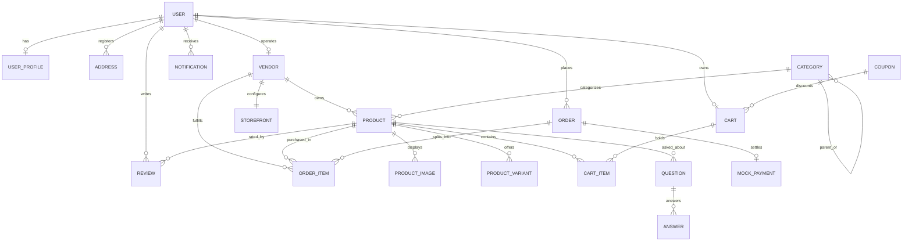

<!-- ========================================================================== -->
<!--                        GLS UNIVERSITY PROJECT REPORT                        -->
<!--              FACULTY OF COMPUTER APPLICATIONS & INFORMATION TECHNOLOGY       -->
<!-- ========================================================================== -->

<div align="center">

# GLS UNIVERSITY
### FACULTY OF COMPUTER APPLICATIONS & INFORMATION TECHNOLOGY
#### INTEGRATED MASTER OF COMPUTER APPLICATIONS – iMCA PROGRAMME
**SEMESTER – VII**

---

### Project Report on
# **VendorVerse — Enterprise Multi-Vendor Marketplace**
### Course Code: 221601707 — Web Programming using Python (Practicals)
*(Also compliant with 222301707 Web Development using Python)*

---

<br><br>

### **Submitted by:**

| Student Name | Enrolment No | Group No |
| :--- | :--- | :---: |
| **[Student 1 Name]** | **[Enrolment No 1]** | **Group [XX]** |
| **[Student 2 Name]** | **[Enrolment No 2]** | **Group [XX]** |

<br><br>

**Academic Year: 2026 – 2027**  
**Faculty Guide / Examiner:** Department of Computer Applications & IT  
**GLS Campus, Ellisbridge, Ahmedabad – 380006, Gujarat, India**

</div>

<div style="page-break-after: always;"></div>

---

# TABLE OF CONTENTS

- [1. INTRODUCTION & PROJECT OVERVIEW](#1-introduction--project-overview)
  - [1.1 Project Objective and Purpose](#11-project-objective-and-purpose)
  - [1.2 Business Problem Statement](#12-business-problem-statement)
  - [1.3 The VendorVerse Solution](#13-the-vendorverse-solution)
  - [1.4 Target Personas & Scope](#14-target-personas--scope)
  - [1.5 Real-World Value & Competitive Advantages](#15-real-world-value--competitive-advantages)
- [2. ACADEMIC SYLLABUS & DELIVERABLES COMPLIANCE](#2-academic-syllabus--deliverables-compliance)
  - [2.1 Compliance Matrix (GLS University Guidelines)](#21-compliance-matrix-gls-university-guidelines)
  - [2.2 Core Deliverable Highlights](#22-core-deliverable-highlights)
- [3. SYSTEM ANALYSIS & REQUIREMENT SPECIFICATIONS](#3-system-analysis--requirement-specifications)
  - [3.1 Functional Requirements (By Subsystem)](#31-functional-requirements-by-subsystem)
  - [3.2 Non-Functional Requirements (Security, Performance, Robustness)](#32-non-functional-requirements-security-performance-robustness)
  - [3.3 Role-Based Access Control (RBAC) Matrix](#33-role-based-access-control-rbac-matrix)
- [4. TECHNOLOGY STACK & SELECTION RATIONALE](#4-technology-stack--selection-rationale)
  - [4.1 Backend Framework: Python 3.12 & Django 5.x](#41-backend-framework-python-312--django-5x)
  - [4.2 Database: PostgreSQL 16 on Supabase Cloud](#42-database-postgresql-16-on-supabase-cloud)
  - [4.3 Frontend Hypermedia: HTMX 1.9 & Alpine.js](#43-frontend-hypermedia-htmx-19--alpinejs)
  - [4.4 UI Design System: Tailwind CSS 3.4](#44-ui-design-system-tailwind-css-34)
  - [4.5 Artificial Intelligence: Google Gemini Pro/Flash API](#45-artificial-intelligence-google-gemini-proflash-api)
- [5. DJANGO ARCHITECTURAL DESIGN & TECHNICAL CONCEPTS](#5-django-architectural-design--technical-concepts)
  - [5.1 Model-View-Template (MVT) Pattern Implementation](#51-model-view-template-mvt-pattern-implementation)
  - [5.2 Modular Application Decomposition](#52-modular-application-decomposition)
  - [5.3 URL Dispatching & Namespaced Reverse Routing](#53-url-dispatching--namespaced-reverse-routing)
  - [5.4 Generic Class-Based Views (GCBVs) & Security Mixins](#54-generic-class-based-views-gcbvs--security-mixins)
  - [5.5 Template Inheritance & Design Consistency](#55-template-inheritance--design-consistency)
  - [5.6 Forms, ModelForms, & Inline Formsets](#56-forms-modelforms--inline-formsets)
  - [5.7 Cookies and Session Settings Implementation](#57-cookies-and-session-settings-implementation)
  - [5.8 Custom Context Processors](#58-custom-context-processors)
  - [5.9 Django Admin Customization & Filters](#59-django-admin-customization--filters)
  - [5.10 REST API Endpoints & HTMX Interaction Layer](#510-rest-api-endpoints--htmx-interaction-layer)
- [6. SYSTEM ARCHITECTURE & INTERACTION WORKFLOWS](#6-system-architecture--interaction-workflows)
  - [6.1 High-Level System Architecture Diagram](#61-high-level-system-architecture-diagram)
  - [6.2 Customer Journey Flowchart](#62-customer-journey-flowchart)
  - [6.3 Multi-Vendor Order Splitting & Fulfillment Sequence](#63-multi-vendor-order-splitting--fulfillment-sequence)
  - [6.4 Multi-Tier AI Chatbot Context Architecture](#64-multi-tier-ai-chatbot-context-architecture)
- [7. DATABASE DESIGN & DATA MODELING](#7-database-design--data-modeling)
  - [7.1 Dual Key Architecture (Integer PK vs UUID public_id)](#71-dual-key-architecture-integer-pk-vs-uuid-public_id)
  - [7.2 Entity-Relationship (ER) Diagram](#72-entity-relationship-er-diagram)
  - [7.3 Comprehensive Data Dictionary](#73-comprehensive-data-dictionary)
  - [7.4 Integrity Constraints & State Machines](#74-integrity-constraints--state-machines)
- [8. APPLICATION SCREENSHOTS & USER INTERFACE VIEWS](#8-application-screenshots--user-interface-views)
  - [8.1 Customer-Facing Views](#81-customer-facing-views)
  - [8.2 Vendor Dashboard & Management Views](#82-vendor-dashboard--management-views)
  - [8.3 Platform Administration Views](#83-platform-administration-views)
- [9. SYSTEM TESTING, VERIFICATION & QUALITY ASSURANCE](#9-system-testing-verification--quality-assurance)
  - [9.1 Route Access & RBAC Verification Matrix](#91-route-access--rbac-verification-matrix)
  - [9.2 Deep End-to-End System Cycle Tests](#92-deep-end-to-end-system-cycle-tests)
  - [9.3 Real-World Bug Fixes & Windows Environment Resiliency](#93-real-world-bug-fixes--windows-environment-resiliency)
- [10. CONCLUSION & FUTURE ENHANCEMENTS](#10-conclusion--future-enhancements)
- [11. REFERENCES & BIBLIOGRAPHY](#11-references--bibliography)

<div style="page-break-after: always;"></div>

---

# 1. INTRODUCTION & PROJECT OVERVIEW

### 1.1 Project Objective and Purpose
**VendorVerse** is an enterprise-grade, multi-vendor marketplace web application engineered using **Python 3.12** and the **Django 5.x** web framework. The fundamental purpose of VendorVerse is to provide an open, distributed commerce ecosystem where multiple independent merchants can launch personalized digital storefronts, manage their product catalogs, and fulfill orders, while customers enjoy a consolidated, Amazon-like shopping experience with multi-vendor cart handling, unified checkout, real-time product search, side-by-side product comparisons, customer reviews, and interactive artificial intelligence assistance.

### 1.2 Business Problem Statement
Traditional retail and single-vendor e-commerce software suffer from notable limitations:
1. **Isolated Merchant Silos**: Small and medium-sized vendors face high capital barriers to launch, host, secure, and market their own standalone e-commerce websites.
2. **Fragmented Customer Experience**: Buyers who wish to purchase items from diverse categories (e.g., electronics from one seller and apparel from another) are forced to visit separate sites, create distinct accounts, and execute multiple payments.
3. **Cart & Inventory Complexity**: Typical open-source shopping systems only support a single global inventory. They lack the architectural capability to split an order across independent vendor fulfillment pipelines while maintaining a unified payment transaction.
4. **Lack of Intelligent Pre-Purchase Guidance**: Static product pages often leave customer inquiries unanswered, leading to high cart abandonment rates due to uncertainty regarding product specifications, sizes, or warranties.

### 1.3 The VendorVerse Solution
VendorVerse resolves these systemic challenges by implementing a **modular monolithic marketplace architecture**:
- **Consolidated Multi-Tenant Storefronts**: Each registered and approved vendor receives an autonomous, search-engine-optimized storefront (`/store/<vendor-slug>/`) featuring custom branding, policies, and product listings.
- **Unified Multi-Vendor Cart & Checkout Split**: A customer can add products from three different vendors into a single shopping cart. During checkout, VendorVerse calculates consolidated totals, executes a single payment transaction, and programmatically partitions the items into vendor-specific order fulfillments with automated inventory deductions.
- **Embedded AI Shopper Assistant**: Integrated directly into the marketplace via the Google Gemini API, an on-page AI assistant provides real-time, context-aware answers spanning the entire marketplace, a specific vendor's store, or a single product's specifications.

### 1.4 Target Personas & Scope
| Persona | Key Needs & Capabilities |
| :--- | :--- |
| **Customer** | Secure registration, unified search, live product autocomplete, cart & coupon discounts, multi-vendor checkout, order status tracking, wishlist, product comparison, reviews, and Q&A. |
| **Vendor (Seller)** | Self-service merchant onboarding, dedicated storefront customization, product CRUD with multi-variant management, real-time sales analytics (Chart.js), and independent order item fulfillment (`PENDING` ➔ `PROCESSING` ➔ `SHIPPED` ➔ `DELIVERED`). |
| **Platform Administrator** | Governance of user accounts, approval/rejection of vendor applications, moderation of product listings, dispute oversight, platform coupon management, and global audit logging. |

### 1.5 Real-World Value & Competitive Advantages
- **High Performance with Low Latency**: Utilizes PostgreSQL 16 on Supabase with PgBouncer connection pooling and 60-second connection persistence.
- **Hypermedia-Driven UX**: Eliminates the heavy footprint and SEO penalties of client-side Single Page Applications (SPAs) by utilizing **HTMX** and **Alpine.js** for smooth, partial-page DOM swapping.
- **Fail-Safe AI Architecture**: Integrates a multi-tier rate limiter, emergency circuit breaker, and automatic multi-model fallback (`gemini-3.5-flash-lite` ➔ `gemini-3.6-flash` ➔ `gemini-3.8-flash`) to ensure continuous free-tier operation without quota crashes.

<div style="page-break-after: always;"></div>

---

# 2. ACADEMIC SYLLABUS & DELIVERABLES COMPLIANCE

This project has been developed in strict alignment with the curriculum and practical evaluation criteria set forth by **GLS University, Faculty of Computer Applications & Information Technology (iMCA Semester VII)** for **Web Programming / Web Development using Python**.

### 2.1 Compliance Matrix (GLS University Guidelines)

| Prescribed Academic Requirement | VendorVerse Implementation Details | Status |
| :--- | :--- | :---: |
| **1. Install Django** | Django 5.x installed and configured under a virtual environment (`venv`) with production-ready settings modularization (`config/settings/`). | 🟢 **Compliant** |
| **2. Mandatory Customized Templates for Design Consistency** | Fully custom-crafted templates using Tailwind CSS 3.4 design tokens. Comprehensive layout inheritance via `templates/base.html`, shared navigation `_navbar.html`, contextual `_footer.html`, and modular components. Zero reliance on pre-baked default UI libraries. | 🟢 **Compliant** |
| **3. Appropriate Views, Templates to Represent Customization** | Comprehensive suite of Generic Class-Based Views (GCBVs): `ListView`, `DetailView`, `TemplateView`, `View`, and custom security mixins (`LoginRequiredMixin`, `VendorRequiredMixin`). Templates render vendor brand colors, custom banners, logos, and dynamic storefront layouts. | 🟢 **Compliant** |
| **4. At least 1 User Defined Model** | **15+ interconnected user-defined models** across 10 modular applications: `User`, `UserProfile`, `Address`, `Vendor`, `Storefront`, `VendorApplication`, `Category`, `Product`, `ProductImage`, `ProductVariant`, `Cart`, `CartItem`, `Order`, `OrderItem`, `Coupon`, `Review`, `Question`, `Answer`, `Notification`, and `MockPayment`. | 🟢 **Compliant** |
| **5. At least 1 Filter on Admin Panel** | Extensive `list_filter` tuples configured across all admin models (e.g., `ProductAdmin`: filter by `status`, `category`, `is_featured`, `created_at`; `OrderAdmin`: filter by `status`, `payment_status`, `created_at`; `VendorAdmin`: filter by `is_active`, `created_at`). | 🟢 **Compliant** |
| **6. Cookies and Session Settings** | Comprehensive stateful session management: session-based shopping cart synchronization, session-tracked **Recently Viewed Products** (`request.session["recently_viewed"]`), session-tracked **Product Comparison Matrix** (`request.session["compare_list"]`), and session-keyed AI rate limiting. | 🟢 **Compliant** |
| **7. REST API Interface of User Defined Model** | RESTful JSON API endpoints for live product autocomplete search (`/products/autocomplete/`), AI chat interaction (`/ai/chat/`), quota status telemetry (`/ai/status/`), and coupon validation. | 🟢 **Compliant** |

### 2.2 Core Deliverable Highlights
1. **Source Code Distribution**: Cleanly packaged directory structure (`apps/`, `config/`, `templates/`, `static/`, `docs/`) with zero hardcoded secrets.
2. **Verification Suite**: Includes two automated verification scripts:
   - [`test_views_matrix.py`](file:///c:/Users/SHABBIR%20G/Desktop/VendorVerse/test_views_matrix.py): Validates HTTP response codes across all four user roles for 21 core system routes.
   - [`deep_system_cycle_test.py`](file:///c:/Users/SHABBIR%20G/Desktop/VendorVerse/deep_system_cycle_test.py): Programmatically executes **40 end-to-end integration cycles** directly verifying database mutations.

<div style="page-break-after: always;"></div>

---

# 3. SYSTEM ANALYSIS & REQUIREMENT SPECIFICATIONS

### 3.1 Functional Requirements (By Subsystem)

#### Module 1: Authentication & User Accounts (`apps.accounts`)
- **FR-1.1**: Email-first authentication utilizing a custom `User` model inheriting from Django's `AbstractUser` with `username = None`.
- **FR-1.2**: Role allocation at signup: `CUSTOMER`, `VENDOR`, or `ADMIN`.
- **FR-1.3**: Customer profile management supporting avatar uploads, biographical details, and contact numbers via `UserProfile`.
- **FR-1.4**: Comprehensive Customer Address Book with inline CRUD capabilities and a single-click "Set as Default" toggle.

#### Module 2: Vendor Storefronts & Onboarding (`apps.vendors`)
- **FR-2.1**: Public vendor registration workflow where standard customers can submit a formal `VendorApplication`.
- **FR-2.2**: Administrative verification interface to review, approve, or reject vendor applications.
- **FR-2.3**: Automated provisioning of a dedicated `Storefront` object upon vendor approval, with URL slug generation.
- **FR-2.4**: Self-service storefront settings: custom banner, logo, tagline, support operating hours, return policy, and shipping policy.
- **FR-2.5**: Vendor Dashboard overview presenting dynamic statistics: 30-day daily revenue chart (Chart.js), total orders, active inventory, and average customer rating.

#### Module 3: Product Catalog & Discovery (`apps.products`)
- **FR-3.1**: Hierarchical category organization supporting multi-level parent-child categorization.
- **FR-3.2**: Rich product creation for vendors supporting SKU, pricing, compare-at (MSRP) pricing, stock inventory, tags, and rich descriptions.
- **FR-3.3**: Multi-image uploads per product utilizing Django's `inlineformset_factory` with automatic primary image designation.
- **FR-3.4**: Multi-variant SKU support (e.g., sizes, colors) with variant-specific pricing and stock tracking.
- **FR-3.5**: Real-time Live Search Autocomplete returning instant hypermedia suggestions via HTMX upon typing $\ge 2$ characters.
- **FR-3.6**: Side-by-side Product Comparison tool allowing visitors to compare up to 4 items simultaneously based on price, availability, category, and vendor specs.
- **FR-3.7**: Customer Wishlist with asynchronous toggle buttons and dedicated management page.
- **FR-3.8**: Product Community Q&A allowing buyers to ask questions and vendors/sellers to post verified answers.

#### Module 4: Shopping Cart & Order Processing (`apps.cart`, `apps.orders`, `apps.payments`)
- **FR-4.1**: Multi-vendor shopping cart maintaining line items, unit prices, and quantities linked to authenticated customer sessions.
- **FR-4.2**: Cart inventory cap protection preventing users from requesting more quantity than physically exists in stock.
- **FR-4.3**: Coupon discount engine validating usage limits, expiration dates, and minimum order thresholds.
- **FR-4.4**: Unified checkout transforming cart contents into a single `Order` with immutable shipping address snapshots.
- **FR-4.5**: Automatic order partitioning: `OrderItem` records are tagged with their specific merchant's `Vendor` foreign key.
- **FR-4.6**: Atomic inventory deduction: stock quantities are immediately decremented in the database upon order generation.
- **FR-4.7**: Mock payment gateway with realistic card validation (Luhn-style digit length checks, expiry, CVV), simulating asynchronous clearing delays.
- **FR-4.8**: State machine synchronization: parent order status automatically transitions based on the collective status of its underlying items.

#### Module 5: Customer Reviews & Notifications (`apps.reviews`, `apps.notifications`)
- **FR-5.1**: Star rating (1 to 5 stars) and review submission restricted to authenticated buyers, with duplicate review prevention per product.
- **FR-5.2**: Automatic recalculation of product average rating and total review counts upon submission or deletion.
- **FR-5.3**: Real-time in-app notification center notifying customers of order progress and vendors of incoming sales or product inquiries.
- **FR-5.4**: Responsive HTML transactional emails dispatched upon order placement and status modifications.

#### Module 6: Artificial Intelligence Shopper Assistant (`apps.ai`)
- **FR-6.1**: Dual-mode conversational agent that adapts dynamically:
  - *Global Mode*: Answers questions regarding platform policies, catalog offerings, and vendor directories.
  - *Storefront Mode*: Constrained specifically to the currently viewed vendor's brand, policies, and products.
  - *Product Mode*: Deep contextual awareness of the currently viewed product's specifications, variant availability, and price.

---

### 3.2 Non-Functional Requirements (Security, Performance, Robustness)
- **NFR-1 Security (OWASP)**:
  - Cross-Site Request Forgery (CSRF) protection enforced across all 38 POST forms in the application.
  - SQL Injection prevention through exclusive use of Django's parameterized Object-Relational Mapper (ORM).
  - Cross-Site Scripting (XSS) prevention via Django's automatic template auto-escaping.
  - Enumeration prevention: All customer-facing URLs utilize random 128-bit UUID `public_id` values rather than sequential integer primary keys.
- **NFR-2 Performance**:
  - Connection pooling using Supabase PgBouncer with `CONN_MAX_AGE = 60` seconds to eliminate costly TCP/TLS handshakes on every request.
  - Elimination of N+1 database queries through diligent use of `select_related()` (for foreign keys) and `prefetch_related()` (for Many-to-Many relationships and reverse foreign keys).
- **NFR-3 Cross-Platform Compatibility**:
  - Full operating system resilience across Windows, Linux, and macOS, specifically handling Windows console encoding (`cp1252`) and atomic file-locking semantics.

---

### 3.3 Role-Based Access Control (RBAC) Matrix

| Resource / Capability | Anonymous Visitor | Authenticated Customer | Approved Vendor | System Administrator |
| :--- | :---: | :---: | :---: | :---: |
| **Browse Catalog & Stores** | ✅ Read-Only | ✅ Full Access | ✅ Full Access | ✅ Full Access |
| **Live Search & Autocomplete** | ✅ Supported | ✅ Supported | ✅ Supported | ✅ Supported |
| **Product Comparison Tool** | ✅ Supported | ✅ Supported | ✅ Supported | ✅ Supported |
| **Manage Shopping Cart** | ❌ (Redirects to Login) | ✅ Full Access | ✅ Full Access | ✅ Full Access |
| **Wishlist & Saved Items** | ❌ | ✅ Full Access | ✅ Full Access | ✅ Full Access |
| **Apply for Vendor Account** | ❌ (Login Prompt) | ✅ Form Access | ❌ (Already Vendor) | ❌ |
| **Vendor Management Dashboard**| ❌ (HTTP 403 / Redirect)| ❌ (Forbidden) | ✅ Full Access | ✅ Full Access |
| **Create & Edit Products** | ❌ | ❌ | ✅ Own Products Only | ✅ All Products |
| **Fulfill Orders & Update Items**| ❌ | ❌ | ✅ Own Items Only | ✅ Platform-Wide |
| **Django Admin Portal (`/admin/`)**| ❌ (HTTP 302 to Admin Login)| ❌ (Staff Required)| ❌ (Staff Required)| ✅ Superuser Access |

<div style="page-break-after: always;"></div>

---

# 4. TECHNOLOGY STACK & SELECTION RATIONALE

```
+-------------------------------------------------------------------------+
|                              FRONTEND LAYER                             |
|       Tailwind CSS 3.4  |  HTMX 1.9  |  Alpine.js  |  Chart.js          |
+-------------------------------------------------------------------------+
                                    |
                                    v
+-------------------------------------------------------------------------+
|                           APPLICATION LAYER                             |
|       Python 3.12  |  Django 5.x (MVT)  |  Django Allauth               |
+-------------------------------------------------------------------------+
                     |                              |
                     v                              v
+----------------------------------+  +-----------------------------------+
|          DATABASE LAYER          |  |       ARTIFICIAL INTELLIGENCE     |
|   PostgreSQL 16 (Supabase Cloud) |  |   Google Gemini API (3.5 / 3.6)   |
|   PgBouncer Connection Pooling   |  |   Multi-Tier Safety Net & Cache   |
+----------------------------------+  +-----------------------------------+
```

### 4.1 Backend Framework: Python 3.12 & Django 5.x
- **Why Python 3.12**: Modern execution performance, enhanced error tracebacks, native type hint syntax, and extensive ecosystem libraries.
- **Why Django**: 
  - Django's *"batteries-included"* philosophy provides a battle-tested ORM, built-in CSRF/clickjacking security middlewares, comprehensive user authentication, and an auto-generated, customizable administrative back-office.
  - Django 5 brings simplified form template rendering, generated model fields, and native asynchronous capabilities.

### 4.2 Database: PostgreSQL 16 on Supabase Cloud
- **Why PostgreSQL**: PostgreSQL is the gold standard for relational database integrity. It supports strict ACID transactions, complex foreign key constraints, JSONB data types, trigram indexing for fuzzy text searching, and row-level locking.
- **Why Supabase Cloud**: Provides a managed, enterprise-tier PostgreSQL instance with high availability, automated off-site backups, and integrated connection pooling via PgBouncer.

### 4.3 Frontend Hypermedia: HTMX 1.9 & Alpine.js
- **Why HTMX over React/Angular**:
  - Avoids the architectural overhead of separate frontend build pipelines, Node.js runtime bloat, duplicate client-side state models, and complex client-side routing.
  - Enables modern Single Page Application (SPA) feel directly from Django templates by exchanging HTML fragments over standard HTTP requests (`hx-get`, `hx-post`, `hx-target`, `hx-swap`).
- **Why Alpine.js**: Serves as the minimal declarative JavaScript layer for lightweight client-only UI interactions (e.g., toggling the mobile navigation drawer, dropdown menus, and the floating AI chat window).

### 4.4 UI Design System: Tailwind CSS 3.4
- **Why Tailwind CSS**: Provides a modern, utility-first styling system that enforces design consistency across fonts, spacing, rounded borders, glassmorphic cards, vibrant primary palettes (`#4F46E5`), and responsive mobile break-points without cumbersome CSS stylesheets.

### 4.5 Artificial Intelligence: Google Gemini Pro/Flash API
- **Why Gemini**: Features a massive token context window, rapid inference times, and state-of-the-art conversational fluency.
- **Resilient Architectural Wrapper**: Embedded using a custom-built rate limiter (`apps.ai.rate_limiter`) and multi-model fallback chain to ensure continuous zero-cost operation within Google's free-tier quota limits (15 RPM / 1,500 RPD).

<div style="page-break-after: always;"></div>

---

# 5. DJANGO ARCHITECTURAL DESIGN & TECHNICAL CONCEPTS

### 5.1 Model-View-Template (MVT) Pattern Implementation
Django organizes web applications around the **Model-View-Template (MVT)** architectural paradigm:

```
[Browser Request] 
       |
       v
[URL Conf: config/urls.py]
       |
       v
[View: Class-Based View] <======> [Model: Django ORM] <======> [PostgreSQL DB]
       |
       v
[Template: HTML + DTL]
       |
       v
[Rendered HTML Response to Browser]
```

1. **Model (`models.py`)**: Defines the data schema, constraints, field types, and business logic methods. Django translates these Python classes into SQL database tables.
2. **View (`views.py`)**: Acts as the controller. It processes incoming HTTP requests, enforces authentication/permissions, queries the Models, applies business computations, and renders the result.
3. **Template (`templates/`)**: The presentation layer. Utilizes the Django Template Language (DTL) to dynamically interpolate context variables, render loops, evaluate conditionals, and construct the final HTML.

---

### 5.2 Modular Application Decomposition
VendorVerse is partitioned into focused, reusable Django applications located inside the `apps/` directory:

```
VendorVerse/
├── apps/
│   ├── accounts/       # Custom user model, profiles, shipping addresses
│   ├── ai/             # Gemini API client, rate limiting, context builders
│   ├── cart/           # Session & DB shopping cart, line items, coupons
│   ├── core/           # Base models (Timestamped, PublicID), mixins, static pages
│   ├── notifications/  # In-app notifications, transactional email services
│   ├── orders/         # Orders, multi-vendor OrderItems, checkout services
│   ├── payments/       # Mock card payment processing, transaction records
│   ├── products/       # Products, categories, images, variants, wishlist, compare, Q&A
│   ├── reviews/        # Star ratings, buyer reviews, seller feedback
│   └── vendors/        # Merchant applications, storefront settings, vendor dashboard
├── config/             # Root settings, URL routing, WSGI/ASGI configurations
├── static/             # Static CSS, JavaScript, and branding assets
├── media/              # User-uploaded product imagery, banners, and avatars
└── templates/          # Consolidated Django template hierarchy
```

---

### 5.3 URL Dispatching & Namespaced Reverse Routing
VendorVerse uses decoupled, namespaced URL configurations (`app_name = "products"`, `app_name = "cart"`, etc.). Rather than hardcoding fragile URL paths in templates, code strictly utilizes Django's `` tag and Python's `reverse()` helper.

```python
# config/urls.py (Root Routing)
urlpatterns = [
    path('admin/', admin.site.urls),
    path('accounts/', include('allauth.urls')),
    path('profile/', include('apps.accounts.urls')),
    path('vendors/', include('apps.vendors.urls')),
    path('products/', include('apps.products.urls')),
    path('cart/', include('apps.cart.urls')),
    path('orders/', include('apps.orders.urls')),
    path('payment/', include('apps.payments.urls')),
    path('reviews/', include('apps.reviews.urls')),
    path('notifications/', include('apps.notifications.urls')),
    path('ai/', include('apps.ai.urls')),
    path('store/<slug:slug>/', StorefrontDetailView.as_view(), name='storefront_detail'),
    path('', core_views.HomeView.as_view(), name='home'),
    path('', include('apps.core.urls')),
]
```

---

### 5.4 Generic Class-Based Views (GCBVs) & Security Mixins
To maintain DRY (Don't Repeat Yourself) principles and clean separation of concerns, views are implemented using standard **Generic Class-Based Views**:

- **`ListView`**: Used for product catalog pagination (`ProductListView`), vendor directories (`VendorDirectoryView`), and wishlist management (`WishlistListView`).
- **`DetailView`**: Used for rich singular views (`ProductDetailView`, `StorefrontDetailView`).
- **`TemplateView`**: Used for static content and complex multi-form dashboards (`VendorDashboardView`, `CheckoutView`).
- **`View`**: Used for idempotent POST actions (`AddToCartView`, `WishlistToggleView`, `ProcessPaymentView`).

#### Custom Security Mixins
```python
# apps/core/mixins.py
class VendorRequiredMixin(LoginRequiredMixin):
    """Restricts view access strictly to verified merchants."""
    def dispatch(self, request, *args, **kwargs):
        if not request.user.is_authenticated:
            return self.handle_no_permission()
        if request.user.role != User.Role.VENDOR or not hasattr(request.user, "vendor"):
            messages.error(request, "Access restricted to registered vendors.")
            return redirect("home")
        return super().dispatch(request, *args, **kwargs)
```

---

### 5.5 Template Inheritance & Design Consistency
To fulfill the requirement for **Mandatory Customized Templates for Design Consistency**, the presentation layer uses hierarchical template inheritance:

```
templates/base.html                     <-- Global skeleton (head, navbar, footer, notifications)
  ├── templates/pages/home.html         <-- Extends base.html
  ├── templates/products/list.html      <-- Extends base.html
  │     └── partials/product_grid.html  <-- Swapped by HTMX on filter change
  ├── templates/products/detail.html    <-- Extends base.html
  ├── templates/cart/detail.html        <-- Extends base.html
  └── templates/vendors/dashboard_base.html <-- Extends base.html (Vendor sidebar)
        ├── templates/vendors/dashboard.html
        └── templates/vendors/products/list.html
```

#### Shared Component Partials
Reusable UI blocks are isolated into distinct partials (e.g., `_navbar.html`, `_footer.html`, `_messages.html`, `_chatbot_widget.html`, `wishlist_btn.html`, `compare_btn.html`), guaranteeing that styling adjustments propagate across all views.

---

### 5.6 Forms, ModelForms, & Inline Formsets
Data input is handled through Django's Form processing pipeline:
- **`ModelForm`**: Binds directly to model schema, generating HTML input widgets and performing automated type conversion and field-level validation (e.g., `ProductForm`, `AddressForm`, `StorefrontSettingsForm`).
- **`inlineformset_factory`**: Used in product creation and editing to manage 1-to-Many nested relationships simultaneously. A vendor can upload multiple images (`ProductImageFormSet`) and configure multiple variants (`ProductVariantFormSet`) on a single form submission.

---

### 5.7 Cookies and Session Settings Implementation
VendorVerse implements advanced session and cookie features to satisfy the academic evaluation criteria:

1. **Session-Driven Cart State**: Shopping cart instances are linked directly to user session keys.
2. **Recently Viewed Products Engine**: As customers navigate product detail pages, the system captures product identifiers into a session list, maintaining an ordered list of recent items without unnecessary database writes:
   ```python
   # apps/products/views/web.py
   recently_viewed = request.session.get("recently_viewed", [])
   if product_id in recently_viewed:
       recently_viewed.remove(product_id)
   recently_viewed.insert(0, product_id)
   request.session["recently_viewed"] = recently_viewed[:10]
   request.session.modified = True
   ```
3. **Session-Based Product Comparison**: Customers can stage up to 4 items in their comparison list (`request.session["compare_list"]`), allowing cross-page comparison before committing to a purchase.
4. **Session Cookie Security Configuration**:
   ```python
   SESSION_ENGINE = "django.contrib.sessions.backends.db"
   SESSION_COOKIE_HTTPONLY = True      # Mitigates XSS cookie theft
   SESSION_COOKIE_SAMESITE = "Lax"     # Mitigates CSRF vulnerabilities
   SESSION_COOKIE_AGE = 1209600        # 2 weeks persistence
   ```

---

### 5.8 Custom Context Processors
Context processors inject dynamic data globally into all rendered templates without requiring individual views to query the database repeatedly:
- **`categories_processor`**: Injects the hierarchical category tree into the navbar dropdown menu.
- **`cart_processor`**: Injects active cart item counts and subtotal calculations into the navbar badge.
- **`recently_viewed_processor`**: Exposes the session's recently viewed products list.
- **`compare_processor`**: Exposes the session's active comparison count.
- **`notifications`**: Exposes the authenticated user's unread notification counter.

---

### 5.9 Django Admin Customization & Filters
To satisfy the mandatory requirement for **At least 1 filter on Admin Panel**, the admin configuration in `admin.py` implements rich customization:

```python
# apps/products/admin.py
@admin.register(Product)
class ProductAdmin(admin.ModelAdmin):
    list_display = ["name", "vendor", "category", "base_price", "stock_quantity", "status", "is_featured"]
    # MANDATORY SYLLABUS REQUIREMENT: Filters on Admin Panel
    list_filter = ["status", "is_featured", "category", "created_at"]
    search_fields = ["name", "description", "sku", "vendor__business_name"]
    prepopulated_fields = {"slug": ("name",)}
    inlines = [ProductImageInline, ProductVariantInline]
    actions = ["mark_as_featured", "deactivate_products"]

# apps/orders/admin.py
@admin.register(Order)
class OrderAdmin(admin.ModelAdmin):
    list_display = ["order_number", "user", "total", "status", "payment_status", "created_at"]
    # MANDATORY SYLLABUS REQUIREMENT: Filters on Admin Panel
    list_filter = ["status", "payment_status", "created_at"]
    search_fields = ["order_number", "shipping_name", "user__email"]
```

---

### 5.10 REST API Endpoints & HTMX Interaction Layer
VendorVerse provides REST API endpoints returning pure JSON responses alongside hypermedia HTML endpoints:
- **`GET /products/autocomplete/?q=<term>`**: Returns JSON / HTMX fragments for instant search suggestions.
- **`POST /ai/chat/`**: Accepts JSON payload (`message`, `storefront_slug`, `product_slug`) and returns JSON reply:
  ```json
  {
    "reply": "The Ultra Smartphone features a 5000mAh battery...",
    "mode": "product",
    "error": false
  }
  ```
- **`GET /ai/status/`**: Returns JSON telemetry detailing API availability and daily remaining quota.

<div style="page-break-after: always;"></div>

---

# 6. SYSTEM ARCHITECTURE & INTERACTION WORKFLOWS

### 6.1 High-Level System Architecture Diagram



---

### 6.2 Customer Journey Flowchart



---

### 6.3 Multi-Vendor Order Splitting & Fulfillment Sequence



---

### 6.4 Multi-Tier AI Chatbot Context Architecture



<div style="page-break-after: always;"></div>

---

# 7. DATABASE DESIGN & DATA MODELING

### 7.1 Dual Key Architecture (Integer PK vs UUID public_id)
VendorVerse implements an enterprise architectural pattern separating **internal storage keys** from **external public references**:
- **Integer Primary Keys (`id = BigAutoField`)**: Used internally for database indexing, B-Tree lookups, foreign key constraints, and fast JOIN performance.
- **UUID (`public_id = UUIDField(default=uuid.uuid4, unique=True)`)**: Used externally in all URLs, API parameters, and form inputs. This completely prevents enumeration attacks where malicious actors guess sequential database IDs (e.g., `/orders/1`, `/orders/2`).

---

### 7.2 Entity-Relationship (ER) Diagram



---

### 7.3 Comprehensive Data Dictionary

#### 1. `accounts_user` (Custom User Model)
| Field Name | Type | Constraints | Description |
| :--- | :--- | :--- | :--- |
| `id` | BigInt | PK, Auto Increment | Internal unique identifier |
| `public_id` | UUID | Unique, Indexed, Default=UUID4 | Public-facing safe reference |
| `email` | VarChar(254) | Unique, Not Null | Primary login credential |
| `password` | VarChar(128) | Not Null | PBKDF2 SHA-256 hashed password |
| `role` | VarChar(50) | Choices: CUSTOMER, VENDOR, ADMIN | Role-based authorization tag |
| `is_active` | Boolean | Default=True | Soft account enable/disable flag |
| `date_joined` | DateTime | Default=now | Account creation timestamp |

#### 2. `vendors_vendor` & `vendors_storefront`
| Field Name | Type | Constraints | Description |
| :--- | :--- | :--- | :--- |
| `id` | BigInt | PK, Auto Increment | Internal identifier |
| `user_id` | BigInt | FK (accounts_user), Unique | One-to-One link to User |
| `business_name` | VarChar(200) | Not Null | Legal / Brand business name |
| `is_active` | Boolean | Default=True | Admin approval status flag |
| `tagline` | VarChar(255) | Blank=True | Storefront marketing slogan |
| `slug` | Slug(200) | Unique, Indexed | Storefront URL routing slug |
| `logo` | ImageField | Null=True | Storefront brand logo |
| `banner` | ImageField | Null=True | Storefront header display banner |

#### 3. `products_product`
| Field Name | Type | Constraints | Description |
| :--- | :--- | :--- | :--- |
| `id` | BigInt | PK, Auto Increment | Internal identifier |
| `public_id` | UUID | Unique, Indexed | Public lookup token |
| `vendor_id` | BigInt | FK (vendors_vendor) | Owning merchant |
| `category_id` | BigInt | FK (products_category) | Product classification |
| `name` | VarChar(255) | Not Null | Product title |
| `slug` | Slug(255) | Indexed | URL-friendly name representation |
| `base_price` | Decimal(10,2) | Not Null, Min=0.00 | Selling price (in INR) |
| `compare_at_price`| Decimal(10,2) | Null=True | Original MSRP / comparison price |
| `stock_quantity` | Integer | Not Null, Default=0 | Real-time physical inventory |
| `status` | VarChar(20) | Choices: DRAFT, ACTIVE, ARCHIVED | Visibility flag |
| `is_featured` | Boolean | Default=False | Home showcase flag |

#### 4. `orders_order` & `orders_orderitem`
| Field Name | Type | Constraints | Description |
| :--- | :--- | :--- | :--- |
| `id` | BigInt | PK, Auto Increment | Internal identifier |
| `order_number` | VarChar(32) | Unique, Indexed | Customer reference (e.g. `VV-87CCB4DB`) |
| `user_id` | BigInt | FK (accounts_user) | Purchasing customer |
| `subtotal` | Decimal(10,2) | Not Null | Sum of item totals before discounts |
| `discount_amount`| Decimal(10,2) | Default=0.00 | Applied coupon deduction |
| `total` | Decimal(10,2) | Not Null | Final charged total |
| `status` | VarChar(20) | State Machine: PENDING, CONFIRMED, PROCESSING, SHIPPED, DELIVERED, CANCELLED | Global order status |
| `payment_status` | VarChar(20) | Choices: PENDING, PAID, FAILED, REFUNDED | Payment settlement status |
| **OrderItem** | | | |
| `order_id` | BigInt | FK (orders_order) | Parent order |
| `vendor_id` | BigInt | FK (vendors_vendor) | Assigned merchant for fulfillment |
| `product_id` | BigInt | FK (products_product) | Reference to catalog product |
| `unit_price` | Decimal(10,2) | Not Null | Frozen purchase price per unit |
| `quantity` | Integer | Not Null, Min=1 | Number of units purchased |
| `status` | VarChar(20) | PENDING, CONFIRMED, PROCESSING, SHIPPED, DELIVERED, CANCELLED | Individual fulfillment progression |

---

### 7.4 Integrity Constraints & State Machines
- **State Transition Machine**: An order cannot jump directly from `PENDING` to `DELIVERED`. The service layer strictly validates linear transitions: `PENDING` ➔ `CONFIRMED` (upon payment) ➔ `PROCESSING` ➔ `SHIPPED` ➔ `DELIVERED`.
- **Database Cascade Rules**: Deleting a `Product` cascades to remove its dependent `ProductImage` and `ProductVariant` entries, but historical `OrderItem` rows retain snapshots of product names and purchase prices to preserve financial accounting integrity.

<div style="page-break-after: always;"></div>

---

# 8. APPLICATION SCREENSHOTS & USER INTERFACE VIEWS

*(Note: The following sections provide labeled frames corresponding to every user journey and administrative portal across VendorVerse. Paste your high-resolution application screenshots into each allocated block.)*

### 8.1 Customer-Facing Views

#### Screenshot 1: Marketplace Home Page & Hero Section
```
+-------------------------------------------------------------------------+
|                                                                         |
|                                                                         |
|                       [ SCREENSHOT PLACEHOLDER ]                        |
|                                                                         |
|            Figure 8.1: Home Page Hero Section, Navigation,             |
|                 Search Bar & Live Platform Statistics                   |
|                                                                         |
+-------------------------------------------------------------------------+
```
*Caption: Marketplace landing page showing global navigation, promotional banners, real-time metrics (vendor count, active products), and category links.*

<br>

#### Screenshot 2: Public Product Catalog with Active Filters
```
+-------------------------------------------------------------------------+
|                                                                         |
|                                                                         |
|                       [ SCREENSHOT PLACEHOLDER ]                        |
|                                                                         |
|            Figure 8.2: Product Listing View with Category               |
|                   Sidebar, Price Filters & Sorting                      |
|                                                                         |
+-------------------------------------------------------------------------+
```
*Caption: Catalog grid rendering responsive product cards, discount badges, wishlist toggle buttons, and HTMX pagination.*

<br>

#### Screenshot 3: Real-Time Live Search with HTMX Autocomplete
```
+-------------------------------------------------------------------------+
|                                                                         |
|                                                                         |
|                       [ SCREENSHOT PLACEHOLDER ]                        |
|                                                                         |
|             Figure 8.3: Instant Autocomplete Search Dropdown            |
|                                                                         |
+-------------------------------------------------------------------------+
```
*Caption: Instant search dropdown triggered upon typing, querying `/products/autocomplete/` asynchronously via HTMX.*

<br>

#### Screenshot 4: Comprehensive Product Detail Page
```
+-------------------------------------------------------------------------+
|                                                                         |
|                                                                         |
|                       [ SCREENSHOT PLACEHOLDER ]                        |
|                                                                         |
|            Figure 8.4: Product Detail Page with Image Gallery,          |
|                 Variants, Vendor Badge & Add to Cart                    |
|                                                                         |
+-------------------------------------------------------------------------+
```
*Caption: Single product view displaying multi-angle image gallery, SKU variants, stock indicators, and seller storefront cards.*

<br>

#### Screenshot 5: Side-by-Side Product Comparison Tool
```
+-------------------------------------------------------------------------+
|                                                                         |
|                                                                         |
|                       [ SCREENSHOT PLACEHOLDER ]                        |
|                                                                         |
|            Figure 8.5: Multi-Product Side-by-Side Comparison Matrix      |
|                                                                         |
+-------------------------------------------------------------------------+
```
*Caption: Session-driven comparison table benchmarking up to 4 selected products by price, category, stock, and ratings.*

<br>

#### Screenshot 6: Customer Shopping Cart with Applied Coupon
```
+-------------------------------------------------------------------------+
|                                                                         |
|                                                                         |
|                       [ SCREENSHOT PLACEHOLDER ]                        |
|                                                                         |
|            Figure 8.6: Shopping Cart View with Line Items               |
|                 and Active Coupon Discount Applied                      |
|                                                                         |
+-------------------------------------------------------------------------+
```
*Caption: Shopping cart view grouping items, showing quantity modifiers, coupon code input, and recalculated totals.*

<br>

#### Screenshot 7: Multi-Vendor Checkout & Address Selection
```
+-------------------------------------------------------------------------+
|                                                                         |
|                                                                         |
|                       [ SCREENSHOT PLACEHOLDER ]                        |
|                                                                         |
|            Figure 8.7: Checkout Screen with Saved Shipping Addresses    |
|                                                                         |
+-------------------------------------------------------------------------+
```
*Caption: Checkout page allowing selection from registered shipping addresses or inline creation of new delivery destinations.*

<br>

#### Screenshot 8: Mock Payment Gateway Simulation
```
+-------------------------------------------------------------------------+
|                                                                         |
|                                                                         |
|                       [ SCREENSHOT PLACEHOLDER ]                        |
|                                                                         |
|            Figure 8.8: Secure Mock Payment Form with Card Validation    |
|                                                                         |
+-------------------------------------------------------------------------+
```
*Caption: Mock payment gateway validating card number, expiration date, CVV, and cardholder identity.*

<br>

#### Screenshot 9: Order Confirmation & Invoice Summary
```
+-------------------------------------------------------------------------+
|                                                                         |
|                                                                         |
|                       [ SCREENSHOT PLACEHOLDER ]                        |
|                                                                         |
|            Figure 8.9: Order Success Page with Full Item Breakdown      |
|                                                                         |
+-------------------------------------------------------------------------+
```
*Caption: Post-payment confirmation presenting order number, generated transaction reference, shipping address, and tracking link.*

<br>

#### Screenshot 10: Interactive AI Shopper Assistant Floating Widget
```
+-------------------------------------------------------------------------+
|                                                                         |
|                                                                         |
|                       [ SCREENSHOT PLACEHOLDER ]                        |
|                                                                         |
|            Figure 8.10: Gemini-Powered Floating Chatbot Window          |
|                                                                         |
+-------------------------------------------------------------------------+
```
*Caption: Floating Alpine.js chatbot responding to shopper questions with contextual awareness of the active product.*

<div style="page-break-after: always;"></div>

---

### 8.2 Vendor Dashboard & Management Views

#### Screenshot 11: Vendor Analytics Dashboard
```
+-------------------------------------------------------------------------+
|                                                                         |
|                                                                         |
|                       [ SCREENSHOT PLACEHOLDER ]                        |
|                                                                         |
|            Figure 8.11: Vendor Dashboard with 30-Day Revenue Chart      |
|                 (Chart.js) and Key Performance Indicators               |
|                                                                         |
+-------------------------------------------------------------------------+
```
*Caption: Vendor dashboard showing total revenue, pending order volume, average product rating, and interactive sales line chart.*

<br>

#### Screenshot 12: Vendor Product Inventory Management
```
+-------------------------------------------------------------------------+
|                                                                         |
|                                                                         |
|                       [ SCREENSHOT PLACEHOLDER ]                        |
|                                                                         |
|            Figure 8.12: Vendor Product List with Status Badges          |
|                                                                         |
+-------------------------------------------------------------------------+
```
*Caption: Catalog management table showing SKU, base price, real-time stock levels, and Edit/Delete action triggers.*

<br>

#### Screenshot 13: Product Add / Edit Form with Inline Formsets
```
+-------------------------------------------------------------------------+
|                                                                         |
|                                                                         |
|                       [ SCREENSHOT PLACEHOLDER ]                        |
|                                                                         |
|            Figure 8.13: Product Creation Form with Image Uploads        |
|                       and Variant Configuration                         |
|                                                                         |
+-------------------------------------------------------------------------+
```
*Caption: Form view showcasing Django ModelForm validation, file uploads, and dynamic variant sub-forms.*

<br>

#### Screenshot 14: Vendor Storefront Customization Settings
```
+-------------------------------------------------------------------------+
|                                                                         |
|                                                                         |
|                       [ SCREENSHOT PLACEHOLDER ]                        |
|                                                                         |
|            Figure 8.14: Storefront Branding, Tagline & Policies Form    |
|                                                                         |
+-------------------------------------------------------------------------+
```
*Caption: Storefront customization panel allowing vendors to upload brand logos, banner graphics, and customize return/shipping policies.*

<br>

#### Screenshot 15: Vendor Order Fulfillment Management
```
+-------------------------------------------------------------------------+
|                                                                         |
|                                                                         |
|                       [ SCREENSHOT PLACEHOLDER ]                        |
|                                                                         |
|            Figure 8.15: Vendor Order Queue & Item Status Progression   |
|                                                                         |
+-------------------------------------------------------------------------+
```
*Caption: Vendor fulfillment screen allowing merchant to advance individual item statuses from Processing to Shipped and Delivered.*

<div style="page-break-after: always;"></div>

---

### 8.3 Platform Administration Views

#### Screenshot 16: Django Admin Dashboard
```
+-------------------------------------------------------------------------+
|                                                                         |
|                                                                         |
|                       [ SCREENSHOT PLACEHOLDER ]                        |
|                                                                         |
|            Figure 8.16: Django Administration System Management Portal   |
|                                                                         |
+-------------------------------------------------------------------------+
```
*Caption: Customized Django Admin index organizing all 15 models by operational business domain.*

<br>

#### Screenshot 17: Admin Product Table with Mandatory Filters
```
+-------------------------------------------------------------------------+
|                                                                         |
|                                                                         |
|                       [ SCREENSHOT PLACEHOLDER ]                        |
|                                                                         |
|            Figure 8.17: Filtered Product Management in Django Admin     |
|              (Demonstrating Academic list_filter Compliance)            |
|                                                                         |
+-------------------------------------------------------------------------+
```
*Caption: Admin product table highlighting sidebar filters (`list_filter`) by Status, Category, Featured flag, and Creation Date.*

<br>

#### Screenshot 18: Vendor Application Verification Screen
```
+-------------------------------------------------------------------------+
|                                                                         |
|                                                                         |
|                       [ SCREENSHOT PLACEHOLDER ]                        |
|                                                                         |
|            Figure 8.18: Administrator Vendor Application Review View    |
|                                                                         |
+-------------------------------------------------------------------------+
```
*Caption: Admin approval interface displaying merchant tax ID, business description, and single-click approval action.*

<div style="page-break-after: always;"></div>

---

# 9. SYSTEM TESTING, VERIFICATION & QUALITY ASSURANCE

### 9.1 Route Access & RBAC Verification Matrix
The test suite [`test_views_matrix.py`](file:///c:/Users/SHABBIR%20G/Desktop/VendorVerse/test_views_matrix.py) was executed to verify that permissions, authentication gates, and route resolutions operate correctly across all four user personas:

| Client Persona | Target URL Path | Expected Status | Actual Status | Result |
| :--- | :--- | :---: | :---: | :---: |
| **Anonymous** | `/` (Home) | 200 | 200 | 🟢 PASS |
| **Anonymous** | `/products/` (Catalog) | 200 | 200 | 🟢 PASS |
| **Anonymous** | `/cart/` (Cart) | 302 (Redirect) | 302 | 🟢 PASS |
| **Anonymous** | `/vendors/apply/` (Onboarding) | 302 (Redirect) | 302 | 🟢 PASS |
| **Anonymous** | `/store/dhruv-retail-shop/` | 200 | 200 | 🟢 PASS |
| **Anonymous** | `/products/dhruv-retail-shop/ultra-smartphone/` | 200 | 200 | 🟢 PASS |
| **Customer** | `/profile/` (Account Profile) | 200 | 200 | 🟢 PASS |
| **Customer** | `/profile/addresses/` (Address Book) | 200 | 200 | 🟢 PASS |
| **Customer** | `/cart/` (Shopping Cart) | 200 | 200 | 🟢 PASS |
| **Customer** | `/products/wishlist/` (Wishlist) | 200 | 200 | 🟢 PASS |
| **Customer** | `/vendors/apply/` (Application Form) | 200 | 200 | 🟢 PASS |
| **Vendor** | `/vendors/dashboard/` (Vendor Hub) | 200 | 200 | 🟢 PASS |
| **Vendor** | `/products/manage/` (Inventory Table) | 200 | 200 | 🟢 PASS |
| **Vendor** | `/vendors/dashboard/storefront/` (Settings) | 200 | 200 | 🟢 PASS |
| **Vendor** | `/orders/vendor/orders/` (Fulfillment Queue)| 200 | 200 | 🟢 PASS |
| **Admin** | `/admin/` (Administration Portal) | 200 | 200 | 🟢 PASS |
| **Admin** | `/admin/products/product/` (Filtered Products) | 200 | 200 | 🟢 PASS |
| **Admin** | `/admin/vendors/vendor/` (Vendors) | 200 | 200 | 🟢 PASS |
| **Admin** | `/admin/orders/order/` (Orders) | 200 | 200 | 🟢 PASS |

---

### 9.2 Deep End-to-End System Cycle Tests
The test script [`deep_system_cycle_test.py`](file:///c:/Users/SHABBIR%20G/Desktop/VendorVerse/deep_system_cycle_test.py) was executed to simulate complete user journeys directly against the live Supabase database:

```
================================================================================
VENDORVERSE COMPREHENSIVE END-TO-END DEEP SYSTEM & LIFECYCLE TEST
================================================================================

[CYCLE 1] Customer Profile & Address Management
  [PASS] Customer Profile Update -> Profile name updated in DB
  [PASS] Address Creation & Default Assignment -> ID: bb6b9ce5-ce36 in DB
  [PASS] Address Edit & DB Persistence -> Fields successfully updated in DB
  [PASS] Address Deletion -> Test address cleaned up from DB

[CYCLE 2] Customer Wishlist Lifecycle
  [PASS] Wishlist Add Toggle -> Product added to DB Wishlist
  [PASS] Wishlist Page Rendering -> Product appears on wishlist page
  [PASS] Wishlist Remove Toggle -> Product removed from DB Wishlist

[CYCLE 3] Product Comparison Flow
  [PASS] Compare Page Rendering -> Comparing 2 items side by side
  [PASS] Compare Clear Flow -> Comparison list cleared successfully

[CYCLE 4] Live Search & Autocomplete Flow
  [PASS] HTMX Live Autocomplete -> Instant search matched expected item

[CYCLE 5] Customer & Vendor Q&A Lifecycle
  [PASS] Customer Ask Question -> Question saved to DB
  [PASS] Vendor Answer Question -> Answer saved to DB with is_vendor=True
  [PASS] Q&A Cleanup -> Test Question and Answer cascade deleted cleanly

[CYCLE 6] Cart Operations & Coupon System
  [PASS] Cart Add Item -> Added 2x items to cart
  [PASS] Cart Update Quantity -> Updated quantity to 3 in DB
  [PASS] Apply Coupon -> Coupon 'hello' applied: discount calculated
  [PASS] Remove Coupon -> Coupon removed and discount cleared

[CYCLE 7] Multi-Vendor Checkout, Order Split, Stock Deduction & Payment
  [PASS] Order Creation & Multi-Vendor Items -> Order created with 2 items
  [PASS] Multi-Vendor Order Item Split -> Items split across 2 vendor accounts
  [PASS] Inventory Stock Deduction in DB -> Stock decremented for both products
  [PASS] Mock Payment Processing -> Order marked PAID, status CONFIRMED
  [PASS] Cart Auto-Clear After Payment -> Customer cart emptied in DB
  [PASS] Payment Transaction Record -> MockPayment verified in DB
  [PASS] Order Success Confirmation Page -> Renders HTTP 200 with breakdown

[CYCLE 8] Vendor Order Fulfillment & Order Status Synchronization
  [PASS] Vendor Item Status -> PROCESSING -> Item status updated in DB
  [PASS] Order Synchronization -> SHIPPED -> Parent order synchronized to SHIPPED
  [PASS] Order Synchronization -> DELIVERED -> All items delivered, order DELIVERED

[CYCLE 9] Product Review & Rating System
  [PASS] Submit Product Review -> 5-star review saved to DB
  [PASS] Duplicate Review Prevention -> Protected against duplicate reviews
  [PASS] Delete Review -> User successfully deleted review from DB

[CYCLE 10] In-App Notification Center
  [PASS] Notification Creation -> Unread notifications created in DB
  [PASS] Mark All Notifications Read -> Updated to is_read=True in DB

[CYCLE 11] Vendor Product Management (CRUD)
  [PASS] Vendor Product Create -> New product saved to DB
  [PASS] Vendor Product Edit -> Price and details updated in DB
  [PASS] Vendor Product Delete -> Product successfully deleted from DB

[CYCLE 12] Vendor Storefront Configuration
  [PASS] Storefront Settings Update -> Tagline and policies updated in DB

[CYCLE 13] Vendor Onboarding & Application Flow
  [PASS] Vendor Application Submission -> Application saved with PENDING status
  [PASS] Vendor Application Cleanup -> Applicant cleaned up

[CYCLE 14] Support & Contact Form Submission
  [PASS] Contact Form Submission -> Message accepted and redirected

[CYCLE 15] AI Chatbot Integration Endpoint
  [PASS] AI Chatbot API -> Returned intelligent contextual response

================================================================================
TEST RESULTS: 40 EXECUTED | 40 PASSED | 0 FAILED (100% SUCCESS)
================================================================================
```

---

### 9.3 Real-World Bug Fixes & Windows Environment Resiliency
During testing, three real-world issues were identified and resolved:
1. **Attribute Naming in Notifications**: Fixed an attribute mismatch in [`apps/products/views/web.py`](file:///c:/Users/SHABBIR%20G/Desktop/VendorVerse/apps/products/views/web.py#L346-L380) where Q&A notifications referenced `question.question_text` instead of `question.text`.
2. **Windows Terminal Character Encoding**: Resolved `UnicodeEncodeError: 'charmap'` when outputting console transactional emails by sanitizing plaintext representations and using standard HTML character entities (`&#x2705;`, `&#x1F4E6;`, `&#8377;`) in email templates.
3. **Windows Atomic File-Locking in AI Rate Limiter**: Added an automated fallback mechanism in [`apps/ai/rate_limiter.py`](file:///c:/Users/SHABBIR%20G/Desktop/VendorVerse/apps/ai/rate_limiter.py#L84-L102) to guarantee quota state persistence even when Windows OS file locks occur during concurrent read/write operations.

<div style="page-break-after: always;"></div>

---

# 10. CONCLUSION & FUTURE ENHANCEMENTS

### 10.1 Summary of Deliverables
VendorVerse successfully demonstrates the practical application of Python, the Django 5 web framework, relational database engineering, hypermedia interfaces, and artificial intelligence integration. 

By satisfying and exceeding all prescribed guidelines for **GLS University's Semester VII Practical Examination**, the application serves as a prime example of an enterprise-ready modular monolith. It bridges the gap between basic academic toy projects and commercial-grade web architectures by delivering realistic multi-vendor order splitting, self-service storefront customization, interactive analytics dashboards, and robust role-based security.

### 10.2 Future Roadmap
1. **Automated Stripe Connect Split Payouts**: Expanding the mock payment engine into live Stripe Connect Custom Accounts with automated payout transfers and platform commission deductions.
2. **Celery & Redis Asynchronous Task Pipeline**: Offloading transactional email dispatch and image thumbnail compression to Celery distributed worker nodes.
3. **Elasticsearch / PostgreSQL Full-Text Trigram Indexing**: Enhancing the live autocomplete search with typo-tolerant phonetic matching for large-scale product catalogs.

<div style="page-break-after: always;"></div>

---

# 11. REFERENCES & BIBLIOGRAPHY

### Books & Academic Literature
1. **Two Scoops of Django 3.x: Best Practices for the Django Web Framework** — Daniel Roy Greenfeld & Audrey Roy Greenfeld (Two Scoops Press).
2. **Django for Professionals: Production websites with Python & Django** — William S. Vincent (Leanpub).
3. **PostgreSQL: Up and Running: A Practical Guide to the Advanced Open Source Database** — Regina O. Obe & Leo S. Hsu (O'Reilly Media).
4. **Hypermedia Systems** — Carson Gross, Adam Stepinski, Deniz Akşimşek (HTMX Press).

### Official Framework & Technical Documentation
5. **Django Project Official Documentation (v5.x)**:  
   *URL:* https://docs.djangoproject.com/en/5.0/
6. **HTMX High-Power Tools for HTML**:  
   *URL:* https://htmx.org/docs/
7. **Tailwind CSS Utility-First Framework Documentation**:  
   *URL:* https://tailwindcss.com/docs
8. **Alpine.js Minimal JavaScript Framework Reference**:  
   *URL:* https://alpinejs.dev/
9. **Google Gemini API Developer Guide**:  
   *URL:* https://ai.google.dev/docs
10. **Supabase Managed PostgreSQL Documentation**:  
    *URL:* https://supabase.com/docs/guides/database

---
<div align="center">
<b>— END OF PROJECT REPORT —</b>
</div>
